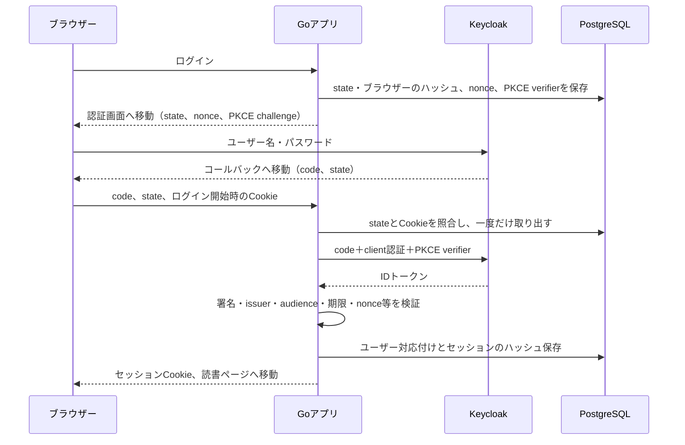

# ADR-0003：ローカル認証とDBセッション

日付：2026-11-14。採用。ADR-0002のGo・OIDC方針を具体化する。

## 今回決めること・採用理由・完了条件

Keycloakがパスワードを扱い、GoがOIDCの結果を検証する。Authorization Code + PKCE S256とconfidential clientを使う。認証サービスとの境界、ブラウザーとの結び付き、セッション失効を学べるため。2ユーザーのログイン・ログアウト、改ざん・期限切れ・再送の拒否を完了条件とする。

## 決定とトレードオフ

| 対象 | 決定と理由 |
| --- | --- |
| Keycloak | 26.8.2をComposeで固定。ローカル専用start-devと名前付きボリューム上の開発用DBを使う。少ない構成で再起動後も利用者を保持できる。AWSではCognitoへ置き換える |
| ログイン途中の状態 | DBのlogin_requestsへ5分間保存。stateとブラウザーCookieを別の乱数にし、それぞれのハッシュを照合する。成功・失敗のコード交換前に一度だけ取り出して削除する |
| DBを使う理由 | アプリ再起動や複数タスクでも同じ状態を参照できる。メモリだけに保存する案よりDB操作が増えるが、失効と期限を一か所で確認できる |
| IDトークン | go-oidcでRS256署名・issuer・audience・期限を検証。Go側でnonce、subject、発行時刻、azpも確認する。メールアドレスによるアカウント自動連携はしない |
| セッション | 256ビットの乱数をCookieへ渡し、DBにはSHA-256ハッシュだけ保存。8時間の固定期限。アクセスのたびにDBで期限・失効を確認する |
| ログインし直し | セッションを新しく発行し、現在のブラウザーが送った古いセッションを同じDBトランザクションで削除する |
| ログアウト | POST＋同一Origin＋セッションに対応するCSRFトークンで実行。DB行を削除してCookieも失効させる |
| IdP側の状態 | 今回のログアウト対象はアプリのセッション。KeycloakのSSOセッションは残る。次のログインはprompt=loginで必ず再認証する。全サービスからのログアウト・back-channel logoutは後の拡張 |
| Token保持 | ID/アクセストークンはコード交換後の検証にだけ使い、DB・ブラウザーの永続ストレージへ保存しない。refresh tokenによる自動延長も行わない |
| Cookie | HttpOnly、SameSite=Lax、Path=/、Domain指定なし。HTTPS構成ではSecureと__Host-接頭辞。HTTPはlocalhost/loopbackだけ許可 |
| 負荷制限 | ログイン開始・コールバックはアプリ全体で平均1回/秒、最大20回のバースト。個人開発用の小さな上限。利用者が増えたら共有レート制御と単位を見直す |
| 期限切れデータ | ログイン開始時に掃除する。掃除前でも期限をSQLで確認するため、期限切れの行は利用できない |

セッションの8時間はIDトークンの期限と別に管理する。IdPでユーザーを無効化してもアプリの既存セッションが直ちに消える構成ではない。即時失効連携は別の実装・検証が必要になる。

## 通信の流れ

## 公式資料

2026-11-14確認。

- [Keycloak 26.8.2](https://www.keycloak.org/2026/11/keycloak-2682-released)
- [Keycloak realmの読み込みと環境変数](https://www.keycloak.org/server/importExport)
- [Keycloak hostname](https://www.keycloak.org/server/hostname)
- [go-oidc：署名等の検証とnonceの確認責任](https://pkg.go.dev/github.com/coreos/go-oidc/v3/oidc)
- [Go OAuth2：PKCE](https://pkg.go.dev/golang.org/x/oauth2)
