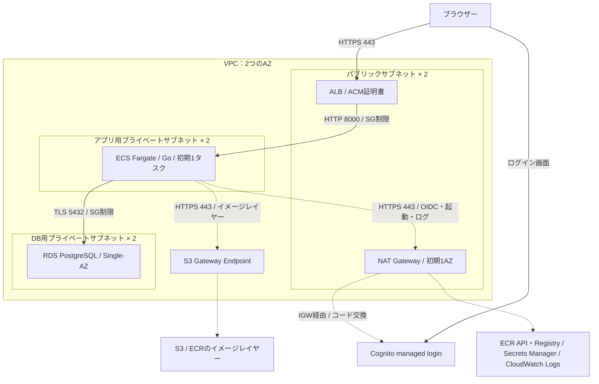

# フェーズ1：構成案と最初の到達点

更新日：2026-11-11（日本時間）

状態：Goアプリの骨組みを実装し、HTTP応答・ログ・テスト・正常終了を確認済み。DB・OIDC・CRUD・Terraform・AWS実機検証は未実施。進捗は[TODO](../TODO.md)、Go・OIDCの採用理由は[ADR-0002](adr/0002-go-and-oidc.md)を参照。

## 進め方

- 利用者はAWS、Terraform、Docker、開発技術の多くに触れた経験がある。実装しながら必要な箇所を説明する。
- 週の作業時間・完成期限は固定しない。
- 個人開発として、単一アプリ・単一環境から始める。細かな変更ごとの設計文書、形式的な承認、多層の抽象化を増やさない。認証・認可・秘密情報の保護は維持する。
- 当面はAWSリソースを作成せず、ローカル実装・検証とインフラ定義の作成を進める。
- 料金の詳細比較は実際のAWS展開前に行う。東京リージョンを仮置きし、その時点の構成・稼働時間・公式単価で再見積もりする。
- 「実装済み」「ローカル検証済み」「AWS実機検証済み」を区別する。ローカルでの成功だけではIAM、AWS上の通信、RDS復元、GitHub OIDCの動作は確定しない。

## 最小の業務要件

「タスク」は読書タスクとして扱う。書籍カタログと汎用タスクの二重管理は初期範囲に含めない。

| 対象 | 初期仕様 |
| --- | --- |
| 読書タスク | 書名、状態（未読・読書中・読了）、任意のメモ、所有ユーザー、作成・更新日時 |
| 操作 | 作成、一覧、編集、削除 |
| 認証 | OIDCによるログイン、ログアウト。初期ユーザーは認証サービス側で作成 |
| 認可 | 一般ユーザーは自分のタスクだけ参照・変更可能 |
| 画面 | ログイン、一覧、追加・編集、削除確認。入力欄の必要なラベルは残す |

初期版に公開ユーザー登録、メール送信、外部書籍検索API、画像アップロード、共有機能は含めない。これは最小版の範囲であり、後続で追加できる。

## アプリ構成

Go + 標準ライブラリの `net/http` / `html/template` + PostgreSQLを採用する。DB接続にはpgxを使い、SQLとマイグレーションを明示的に管理する。大きなWebフレームワークやSPAは初期版に導入しない。バージョンは実装開始時にサポート期間を確認して固定する。

- HTTPルーティング、入力検証、エラー処理、タイムアウト、正常終了処理をGoで組み立てる。
- 認証サービスとの連携はOpenID ConnectのAuthorization Code Flow + PKCE（S256）を使う。
- ローカルの認証サービスはKeycloak、AWSではCognito User Poolのmanaged loginを使う。パスワードの保存・照合は認証サービスへ委ねる。
- Go側では `coreos/go-oidc/v3` と `golang.org/x/oauth2` を利用する。署名検証や暗号処理そのものを独自実装しない。
- 所有者単位の認可はGoアプリで実装する。認証サービスでログインに成功しても、各タスクの操作権限が決まるわけではない。
- 検証済みIDトークンのissuerとsubject（`iss` + `sub`）から内部ユーザーIDを決める。メールアドレスを所有者識別子に使わない。
- 作成時の所有者は認証済みの内部ユーザーIDからサーバー側で設定する。フォームの所有者指定は受け付けない。
- 一覧・取得・更新・削除のすべてで所有者を条件に含める。他人のIDへのアクセスは404に統一する。
- ローカルではDocker ComposeでWeb、PostgreSQL、Keycloakを動かす。Go単体の開発・テストはWSL上でも実行できるようにする。AWSではアプリイメージをECRからFargateへ配布する。
- GoのバイナリがHTTPサーバーとして動作する。フロントエンドのビルドにNode.jsを必要としない。
- ブラウザーにはランダムなセッションIDだけをCookieで渡し、セッションはDBで管理する。ID・アクセストークンをlocalStorageへ保存しない。
- 認証コールバックでstate・nonce・PKCEとIDトークンの署名・issuer・audience・有効期限を検証する。使用済みのログイン処理情報は再利用できなくする。
- Cookieの保護、業務操作のCSRF対策、セッションの更新・期限・ログアウトは別途実装する。OIDCのstate検証だけで業務画面のCSRF対策を済ませない。
- KeycloakとCognitoは別の認証基盤であり、ユーザー識別子も異なる。プロバイダー切替でローカルユーザーが自動移行されるとは扱わない。

公式資料：[Go HTTP](https://pkg.go.dev/net/http)、[HTMLテンプレート](https://pkg.go.dev/html/template)、[go-oidc](https://github.com/coreos/go-oidc)、[Go OAuth2](https://pkg.go.dev/golang.org/x/oauth2)、[Cognito PKCE](https://docs.aws.amazon.com/cognito/latest/developerguide/using-pkce-in-authorization-code.html)、[Keycloakコンテナ](https://www.keycloak.org/server/containers)。

## AWS構成案

破線はFargateの起動・秘密情報取得・ログ配信を含む通信。アプリの業務通信とIAM権限を混同しない。

- ALBのために異なる2つのAZにパブリックサブネットを置き、Internet Gatewayへの経路を設定する。
- アプリとDBにはパブリックIPを付けない。アプリ用ルートはNAT Gateway経由の外向き通信を許可し、DB用ルートにはインターネット向けのデフォルト経路を設定しない。
- アプリ用とDB用のサブネットを分け、DB用にはECR等への経路を追加しない。
- ALBはHTTPSを終端する。公開前に独自ドメイン・DNS検証・ACM証明書を用意する。ALBからアプリまでは初期案ではHTTPを使用し、この区間の暗号化は追加要件として判断する。
- 初期はFargate 1タスクとRDS Single-AZ。サブネットが2つあっても、アプリとDBが高可用になるわけではない。AZ障害時の停止を許容する学習環境とする。
- 初期はNAT Gatewayを1AZに配置する。別AZのアプリからも同じNATを使えるが、NAT配置AZの障害に依存し、AZをまたぐ通信費も生じる。アプリを冗長化する段階で各AZの外向き経路も見直す。
- 初期候補はFargate 0.25 vCPU / 1 GiB、RDS db.t4g.micro / gp3 20 GiB。負荷・メモリ使用量を測って調整する。

公式資料：[ALBとサブネット](https://docs.aws.amazon.com/elasticloadbalancing/latest/application/application-load-balancers.html)、[Cognito PrivateLinkの対応範囲](https://docs.aws.amazon.com/cognito/latest/developerguide/vpc-interface-endpoints.html)。

## 外向き通信の比較

| 選択肢 | 利点 | トレードオフ | 初期の扱い |
| --- | --- | --- | --- |
| Interface Endpoints + S3 Gateway Endpoint | 対応するAWSサービスへの通信をプライベートに限定できる | 種類数 × 配置AZ数の時間課金。CognitoのOAuthドメインへの認証コード交換には利用できない | この方式だけでは今回の認証要件を満たさない |
| NAT Gateway + S3 Gateway Endpoint | プライベート配置を維持しつつCognitoのOAuthエンドポイントやAWS APIへ接続できる | ゲートウェイの時間・処理量・IPv4課金。単一AZ配置は障害点になり、他AZからの経路も検討が必要 | 初期採用 |
| NAT Gateway + Interface Endpoints + S3 Gateway Endpoint | OIDCはNAT、ECR・Logs・Secretsはプライベート経路へ分離できる | NATとエンドポイント両方の費用・設定が必要 | 外向き通信制御を深める拡張候補 |
| Fargateをパブリック配置、SGでALBからのみ受信 | NATや多数のエンドポイントを減らせる | パブリックIP課金。アプリのプライベート配置という基本案を変更する | 予算優先時の比較対象 |
| NAT Instance | インスタンスサイズ次第で費用を下げられる | OS更新、転送設定、復旧・可用性を自分で管理する | 初期範囲では見送る |

Cognitoのmanaged login / OAuthドメインはPrivateLinkの対象外であり、Goサーバーからのコード交換に外向きHTTPS経路が必要になる。このため、旧案のエンドポイントのみの構成をNAT + S3 Gatewayへ変更する。ブラウザーからのログイン画面アクセスと、Goサーバーからのトークン取得・OIDCメタデータ/JWKS取得を別の通信として記録する。

ECRのイメージレイヤーを取得するS3通信はGateway Endpointへ流す。S3への送信はS3のプレフィックスリストを用いて制限し、エンドポイントポリシーも用途に合わせる。その他の初期AWS API通信はNAT経由とする。

アプリSGの外向き通信はDBの5432番とHTTPSの443番を中心に設計する。NATやSGだけでは宛先ドメイン単位に制限できないため、「Cognitoにだけ外向き接続可能」とは扱わない。送信先を厳密に絞る構成はエンドポイント・プロキシ等を使う後続の学習対象とする。

依存パッケージはイメージのビルド時に取得する。実行中のコンテナではインターネットからインストールしない。ECRの初回pull-through cacheに依存せず、ビルド済みイメージをプライベートECRへpushする。

料金比較は構成の確定後、[VPC](https://aws.amazon.com/vpc/pricing/)、[PrivateLink](https://aws.amazon.com/privatelink/pricing/)、[Fargate](https://aws.amazon.com/fargate/pricing/)、[ALB](https://aws.amazon.com/elasticloadbalancing/pricing/)、[RDS](https://aws.amazon.com/rds/postgresql/pricing/)の公式情報で更新する。当面の作業では費用を理由に構成を省略しない。

## 権限・秘密情報・ログ

| 境界 | 方針 |
| --- | --- |
| ALB → アプリ | アプリSGの8000番をALBのSGからのみ許可 |
| アプリ → DB | DBの5432番をアプリSGからのみ許可。接続時はTLSと証明書検証 |
| ECS実行ロール | 対象ECRのpull、対象ロググループへの出力、対象Secretの取得。リソース指定できないAPIの例外は理由を記録 |
| アプリのタスクロール | 初期はAWS API権限を付けない。機能追加時に必要な権限だけ追加 |
| DBユーザー | 初期はアプリ専用ユーザーで実行・マイグレーションを行い、対象DB・スキーマに権限を限定する。アプリでRDS管理者は使用しない。実行用と変更用の分離は拡張時に学ぶ |
| 秘密情報 | DB接続情報・OIDCクライアントシークレット等はAWSではSecrets Managerから起動時に注入。値をコード、イメージ、ログへ入れない。更新後のタスク再起動も手順化 |
| Terraform state | 秘密情報を含み得るものとして扱う。Secretの値の投入はリソース定義から分離し、stateへの保存を個別に確認 |
| アプリログ | JSONを標準出力。request_id、イベント、ユーザーID、HTTPステータス、処理時間を記録。認証情報・セッション・メモ本文は記録しない |
| 保存期間 | 初期はCloudWatch Logs 14日を案とし、調査要件に応じて変更 |

公開前にホスト・リダイレクトURI制限、Secure/HttpOnly/SameSite Cookie、CSRF、セッション期限、認証サービスのログイン試行制限を確認する。Goアプリ側のログイン開始・コールバックにも流量制限とエラー処理を設ける。認証コードやトークンが含まれるURLをログへ丸ごと保存しない。アプリの業務上の認可はネットワーク制限やIAMとは別に検証する。

公式資料：[ECS実行ロールとタスクロールの役割](https://docs.aws.amazon.com/AmazonECS/latest/developerguide/task_execution_IAM_role.html)。

## 段階ごとの到達点

| 段階 | 今回決めること | 採用理由 | 完了条件 |
| --- | --- | --- | --- |
| 1A-1：ローカル認証 | Goアプリ、Keycloak、OIDC、セッション | 認証サービスとアプリの責任分担を確かめられる | 2ユーザーでログイン・ログアウト。state/nonce不一致・不正トークン等の拒否を検証 |
| 1A-2：ローカル業務機能 | 読書タスクの項目、所有者による認可 | 検証済みのユーザー情報から業務上の権限を決める | ComposeでCRUDとユーザー間のアクセス拒否を確認。自動テスト成功 |
| 1B：AWS用定義 | 通信経路、SG、IAM、Secrets、Terraformの管理単位 | アプリの必要通信から権限と構成を決められる | Terraformの整形・検証・IaC検査、イメージビルド成功。構成図と設定が一致 |
| 1C：運用準備 | ログ調査、バックアップ・復元、再構築・削除 | 操作手順と検証基準まで含めて運用できる形にする | ローカル障害調査・DB復元を実施。AWS実機用の手順と未検証項目を明記 |
| 後日：AWS実機検証 | リージョン、稼働時間、料金、アカウント・ドメイン | クラウド固有の動作は実環境でのみ確定できる | HTTPSログイン、IAM・SG・起動時通信、CloudWatch調査、RDS復元、再構築・削除を実証 |

### 最初の到達点：1A

1. ローカルでGoアプリ、PostgreSQL、Keycloakを起動し、マイグレーションを実行できる。
2. Keycloakで2人の一般ユーザーを作成し、OIDC経由でそれぞれログイン・ログアウトできる。
3. ユーザーAが自分のタスクを作成・一覧・編集・削除できる。
4. ユーザーBの一覧にAのタスクが出ない。AのIDを直接指定した取得・更新・削除でも拒否され、元のデータが変化しない。
5. 未ログインではタスクへアクセスできない。所有者の改ざん、CSRF違反、OIDCのstate/nonce不一致、不正署名・issuer・audience・期限切れも検証する。
6. コンテナを再起動してもDBの内容が残る。
7. request_idを手掛かりにアプリログから対象操作を追える。ログインの失敗理由を利用者へ過剰に開示しない。

実装時に実際の起動・ユーザー作成・テストコマンドを構築手順へ追加する。アプリの調査ではComposeのWebとKeycloakのログ、設定ではOIDC issuer/client ID/redirect URIとGoの設定項目、DBではマイグレーション状態を確認できるようにする。Keycloakでの成功をCognitoでの成功と扱わず、後日のAWS実機検証で同じ認証フローを再確認する。

### バックアップ・削除の設計方針

- ローカルは論理バックアップから別DBへ復元し、件数・所有者・内容を照合する。
- AWSではRDS自動バックアップを有効にし、初期保持期間を7日とする。スナップショット復元を最初に、ポイントインタイム復元を次の演習にする。
- AWSの復元先は別のDBインスタンスとし、接続先の切替・認証情報・SG・復元時間を記録する。論理バックアップの成功をRDS復元成功と扱わない。
- Terraformのstate基盤、アプリ環境、保持するバックアップを別のライフサイクルで管理する。
- 削除手順には、残すデータ、削除対象、残存するスナップショット・ログ・ECR・stateを明記する。`destroy`を実行しただけで課金ゼロとは判定しない。
- RDSの停止は最大7日で、その後自動再起動する。停止中もストレージ等の課金が残るため、実展開前の稼働計画で考慮する。[公式仕様](https://docs.aws.amazon.com/AmazonRDS/latest/UserGuide/USER_StopInstance.html)

## 後続フェーズとの接続

- フェーズ2はまずAWS認証不要のテストと検査から実装する。OIDC、plan/apply、アプリデプロイは権限を分離して定義し、AWSへ接続するジョブの実行は実展開段階で有効にする。stateはS3の暗号化・バージョニング・S3ロックを使う案とする。[Terraform公式](https://developer.hashicorp.com/terraform/language/backend/s3)
- フェーズ3は保存・通知処理のコードとテスト用イベントから始める。通知失敗・重複・再試行を確認してから、専用の検証用リソースだけを対象とする隔離・復旧処理を追加する。
- GuardDutyのサンプル検知をEventBridgeへ流す検証、実際の通知、実リソースの隔離・復旧はAWS展開後に行う。

## 成果物と検証記録

- 構成図・通信経路：本書を実装に合わせて更新。
- 設計判断：`docs/adr/` に理由・代替案・影響を記録。
- 構築・削除・障害調査・復元手順：実装に合わせて `docs/runbooks/` へ追加。
- 検証結果：`docs/verification/` に実行日、環境、手順、期待結果、実測結果、未検証項目を記録。
- 現時点の検証結果：[Goアプリの骨組み](verification/01-go-foundation.md)をローカルで確認済み。認証・DB・AWSの検証はこれから行う。
