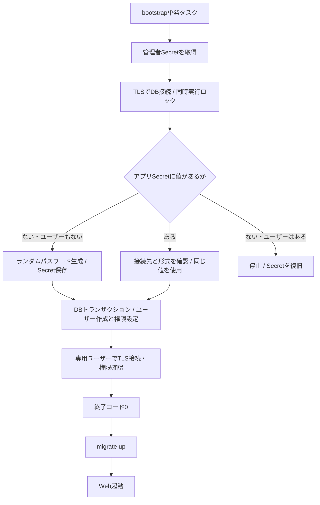

# アプリ専用DBユーザーの初期化

更新日：2026-11-17（日本時間）

今回決めること：管理者の認証情報を初期化専用コマンドへ限定し、アプリの接続URLを別Secretへ保存する。
採用理由：Webへ管理者権限を渡さず、初回セットアップと途中失敗からの再開を同じ手順で行う。
完了条件：専用ユーザーで接続・マイグレーション・保存ができ、再実行と失敗時の動きをローカルで確認する。

今回実装したのはコード・イメージ・IAMの定義。実AWSへのSecret登録・DBユーザー作成は行っていない。タスク定義・起動手順への接続は後続のECS工程で行う。[設計判断](../adr/0004-database-bootstrap.md)

## ファイルと役割

| ファイル | 作ったもの |
| --- | --- |
| `cmd/bootstrap/main.go` | 初期化コマンドの入口。設定確認・AWS SDK・時間制限・正常終了を扱う |
| `internal/bootstrap/bootstrap.go` | DBロック、Secret再利用、ロール作成、権限設定、接続確認 |
| `internal/bootstrap/secrets.go` | 公式SDKでSecretの文字列を取得・保存する部分 |
| `internal/bootstrap/*_test.go` | AWS APIを置き換えるテストと、使い捨て実DBでの検証 |
| `Dockerfile` の `bootstrap` | 初期化コマンドとCAだけを含む実行用イメージ |
| `infra/dev/bootstrap.tf` | 初期化のタスクロールにだけ付けるSecret操作権限 |
| `scripts/verify-database-tls.py --bootstrap` | 一時CA・DBを準備し、検証後に片付ける |

SDKはGoモジュールとしてバージョン固定し、ビルド時に取得する。コンテナ起動後のインストールは不要。AWS CLI・ローカルのAWS認証設定は今回の検証には不要。

## 実行時の順序



既存ユーザーがある場合は、管理権限・ロール所属が増えていないことと、保存済みパスワードで接続できることを先に調べる。パスワードの上書きで問題を隠さない。管理者は `readinglog_admin`、DBとアプリユーザーは `readinglog` に限定する。

アプリは `public` スキーマ内にテーブルを作成できるが、DB所有者にはしない。DB作成、ロール作成、レプリケーション、RLSの迂回は許可しない。対象DBのPUBLICに対する既定権限を取り除き、アプリへCONNECT、publicスキーマへのUSAGE/CREATEを付ける。将来別用途のユーザーを同じDBへ追加する場合は、必要な権限を個別に付ける。

## ローカルで確認する

プロジェクトルートで実行する。Docker Desktop、Go、Python 3、OpenSSLを使う。

```bash
bash scripts/go.sh test ./...
bash scripts/go.sh vet ./...
python3 scripts/verify-database-tls.py --bootstrap
bash scripts/check-terraform.sh
docker build --target bootstrap -t readinglog-bootstrap:local .
```

検証DBは通常のComposeとは別コンテナで、一時ポートを127.0.0.1へ公開する。管理者もスーパーユーザーではない専用ロールにし、TLS通信で初期化する。AWS APIはメモリ上の代替にするため、AWSへ値を送らない。終了時は作成したコンテナ・匿名ボリューム・一時鍵を削除し、既存DBと `.env` を変更しない。強制終了時は `reading-log-tls-` の当該コンテナと `.cache/tls-*` の当該ディレクトリだけを確認して片付ける。

`bootstrap` を引数なしで実行すると `usage: bootstrap initialize` と終了コード1になる。AWS設定や認証情報を読む前に終了する。

## 後日のAWS実行設定

料金・接続先を確認した後、ECS工程で以下の設定を単発タスクへ接続する。まだこの段階のAWSコマンドは実行しない。

| 項目 | 設定 |
| --- | --- |
| イメージ / コマンド | `reading-log-dev/bootstrap` の固定digest / `initialize` |
| ネットワーク | アプリ用プライベートサブネット、アプリSG、public IPなし。RDSへ5432、Secrets ManagerへNAT経由443 |
| 実行ロール | bootstrap専用。自身のECRのpull・ログ送信だけ |
| タスクロール | bootstrap専用。管理者SecretのGet、アプリSecretのGet/Putだけ |
| `DB_HOST` | Terraformの `database.address` に対応するRDSホスト名 |
| `MASTER_SECRET_ARN` | `database.master_secret_arn` |
| `APP_SECRET_ARN` | `database.database_url_secret_arn` |
| 固定値 | 東京、5432番、DB名readinglog、CAパス `/app/certs/ap-northeast-1-bundle.pem` |
| ログ | `/ecs/reading-log-dev/bootstrap`、14日保持 |

引数・環境変数で渡すのはホスト名とSecret ARNだけ。パスワードはSDKで取得し、コンテナ内のメモリで扱う。接続URLは `net/url` でエンコードし、`sslmode=verify-full`、同梱CA、10秒の接続タイムアウトを設定する。実行全体の上限は2分。

Secretの値が保存されても、DB処理がまだ成功していない場合がある。**bootstrapの終了コード0を確認してからmigrateを実行し、その成功後にWebを起動する。** Secretに値があるだけでWebの起動を許可しない。通常運用のデプロイごとにbootstrapを実行する必要はない。

Secretの初回保存はAWSCURRENTとして行う。書き込み応答を失った場合も、次回の実行は保存済みの値を読んで使う。再実行で不要なSecretバージョンを増やさない。[AWS：PutSecretValue](https://docs.aws.amazon.com/secretsmanager/latest/apireference/API_PutSecretValue.html)

## 失敗したときの確認先

| エラーの要点 | 調べるもの・再開方法 |
| --- | --- |
| `read administrator secret failed` | タスクロールのGet権限、ARN、Secretの状態、HTTPS経路 |
| `administrator database connection failed` | RDS状態、SG、CA、ホスト名、管理者Secret。値は表示しない |
| `already running` | 先行bootstrapタスクの状態。終了後に再実行 |
| `save application secret failed` | アプリSecretの存在・ARN、Put権限。保存済みの可能性があるため削除せず再実行 |
| `create application role failed` / `configure application permissions failed` | 管理者のDB権限とDBログ。Secretを保持したまま原因を直して再実行 |
| `secret does not match` | 別DBのSecretや追加接続設定の混入。接続先と登録手順を確認 |
| `role exists but its secret is missing` | 既存Secretを復旧。ユーザーを消して作り直さない |
| `credentials do not work` | DBとSecretの不整合。稼働中アプリも確認し、別途パスワード復旧を行う |
| `unexpected privileges` | readinglogの管理権限・所属ロール。自動で変更せず意図を確認 |

コマンドは接続URL・パスワード・生のSDK/SQLエラーを出力しない。DB内部のロール作成SQLにはパスワードが含まれるため、RDSのSQL本文ログ設定も[DBの手順](rds-and-secrets.md)に従い、実機で内容を確認する。AWS APIの許可判定は将来のCloudTrail、タスクの停止理由、対象ロールで調べる。秘密値のログ出力を有効にして調査しない。

この処理は初回セットアップ用。パスワードの定期ローテーションや、別エンドポイントへ復元したDBの接続先変更は自動化していない。環境削除時は[既存のRDS・Secret削除手順](rds-and-secrets.md#再構築と削除)に従い、bootstrapのECR・ログ・IAMも削除対象に含める。
