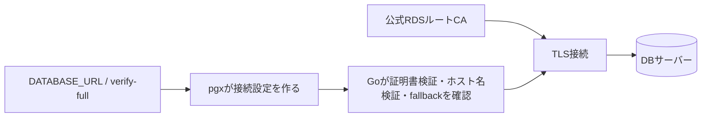

# GoからDBへTLSで接続する

更新日：2026-11-16（日本時間）

今回決めること：GoのDB接続は標準で証明書とホスト名を検証し、ローカルComposeの平文接続は明示的な例外にする。
採用理由：暗号化だけでなく、信頼する接続先かどうかも確認し、平文への切り替えを防ぐ。
完了条件：正しい証明書で接続でき、不正な接続を拒否し、既存ローカルアプリも動く。

## 変更したもの

| ファイル | 役割 |
| --- | --- |
| `internal/database/database.go` | Web・migrate共通のTLS設定検査。検証を省略する設定と平文fallbackを拒否 |
| `internal/database/database_test.go` | TLS未指定・弱いモード・設定ミス・エラーへの秘密情報混入を検査 |
| `internal/database/tls_integration_test.go` | 専用PostgreSQLへ実際に接続し、TLSと拒否パターンを検査 |
| `certs/` | 東京RDSの公開CAと固定チェックサム |
| `Dockerfile` / `.dockerignore` | 指定した公開CAだけをビルドへ渡し、Web/migrateへ同梱 |
| `compose.yaml` / `scripts/setup-local.sh` | ローカル用のTLS例外を明示 |
| `scripts/verify-database-tls.py` | 検証用CAと使い捨てDBを作り、検査後に片付ける |

RDS側の `rds.force_ssl=1` は平文を受け付けない設定。今回のGo側の検証は、DBサーバーを信頼してよいかを確認する処理で、両方が必要。[AWS：PostgreSQLのTLS](https://docs.aws.amazon.com/AmazonRDS/latest/UserGuide/PostgreSQL.Concepts.General.SSL.html)



## 設定方法

`DATABASE_REQUIRE_TLS` は未設定時と `true` のとき、証明書・ホスト名を検証する接続を要求する。`false` はローカル開発用。不正な値や空文字はエラーにする。

URLの文字列だけで判断せず、pgxが作ったTLS設定とfallback先も確認する。`sslmode=require` は暗号化されてもホスト名検証をしないため、標準設定では受け付けない。`allow` / `prefer` の平文への切り替えも受け付けない。[pgx：TLS設定とfallback](https://pkg.go.dev/github.com/jackc/pgx/v5/pgconn#ParseConfig)

AWS用の接続URLは次の形式にする。実際の値は後続の初期化処理からアプリ用Secretへ投入する。

```text
postgres://readinglog:<URLエンコード済みパスワード>@<RDSエンドポイント>:5432/readinglog?sslmode=verify-full&sslrootcert=/app/certs/ap-northeast-1-bundle.pem
```

ホスト名はRDSエンドポイントを使う。IPや別名へ変えると、証明書に含まれる名前と一致しなくなる場合がある。タスク定義でも `DATABASE_REQUIRE_TLS=true` を明示する予定。DB接続用CAの取得元・チェックサム・更新方法は[certsの説明](../../certs/README.md)を参照。

ローカルComposeは既存の平文DBを使うため、Web/migrateに `DATABASE_REQUIRE_TLS=false` を設定している。ホストでGoを動かす場合は、次で既存の `.env` に不足分だけを追加する。

```bash
bash scripts/setup-local.sh
bash scripts/dev.sh run -buildvcs=false ./cmd/web
```

実パスワードは変更しない。ローカルの `false` や `sslmode=disable` をAWS用設定へコピーしない。

## 再実行できる検査

Docker Desktopを起動し、プロジェクトルートで実行する。Go・Python 3・OpenSSLと既存のDockerを使い、追加パッケージの導入は不要だった。

```bash
# DBなしの設定拒否テストと静的検査
bash scripts/go.sh test ./...
bash scripts/go.sh vet ./...

# 使い捨てDBによるTLS検証と片付け
python3 scripts/verify-database-tls.py

# 既存のローカルDBでの統合テスト
docker compose up -d --wait db keycloak
bash scripts/dev.sh test ./...

# 公開CAを含めたWeb・migrateのビルド
docker compose --profile app build web migrate
```

TLS検証スクリプトは一時CA・証明書・ランダムパスワードを作り、`127.0.0.1` の一時ポートへ専用DBを公開する。CAの検証対象として `localhost` だけを持つ証明書を使う。これはAWSのCAで署名されたサーバーを再現するものではなく、pgx/Goの証明書検証とPostgreSQL通信の検査。

| 検査 | 期待結果 |
| --- | --- |
| 正しいCAとlocalhost | 接続成功、`pg_stat_ssl` が暗号化を報告 |
| ホスト名を127.0.0.1へ変更 | 証明書の名前と合わず拒否 |
| 別のCAを指定 | 信頼できない発行者として拒否 |
| CAファイルが存在しない | 接続設定の段階で拒否 |
| `sslmode=prefer` | 検証省略・平文fallbackを許可せず拒否 |
| ローカル例外で平文接続を試す | TLS専用の検証DBが拒否 |

終了時は、作った名前のコンテナ・匿名ボリューム・一時証明書/秘密鍵を削除する。既存ComposeのDB・本・ユーザーと `.env` には触れない。プロセスを強制終了して片付け処理が走らなかった場合だけ、`reading-log-tls-` で始まる当該コンテナと `.cache/tls-*` の当該ディレクトリを確認して削除する。

## ログ・設定の確認先

| エラー | 確認すること |
| --- | --- |
| `DATABASE_REQUIRE_TLS must be true or false` | 環境変数の値。空文字も修正する |
| `DATABASE_URL must verify ...` | `sslmode=verify-full`、ローカルなら明示的な例外設定 |
| `DATABASE_URL is invalid` | URL構文、CAファイルの配置・読み取り権限・内容 |
| `database connection failed ... TLS certificates` | DBの状態・ユーザー、CA、証明書の名前/期限、SGと経路 |

pgxの接続エラーをそのままログへ出すとURLやパスワードを含み得るため、共通処理で安全なメッセージに置き換える。実値が入るURLや環境変数全体をログへ出さず、設定名と状態を確認する。

今回の結果は[検証記録](../verification/10-database-tls.md)へ保存。実RDSへの接続、DBユーザー初期化、Secret値の投入、ECSへの注入は引き続き後続の作業。
