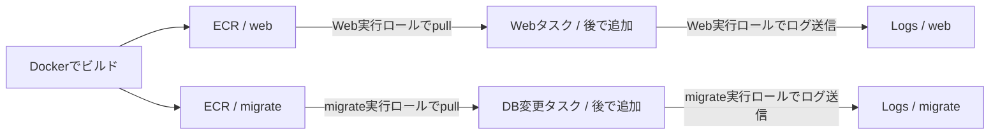

# ECSの準備：イメージ・ログ・実行権限

更新日：2026-11-17（日本時間）

今回決めること：WebとDB変更用のイメージ・ログ・IAMを分け、Fargate用クラスターを用意する。
採用理由：アプリが動く前に、何を配り、どこへ記録し、誰に何を許可するかを具体化する。
完了条件：Terraformの構文検証とmockテストで、保存設定と権限の範囲を確認できる。

今回は定義とローカル検証まで。AWSリソース・イメージのpush・タスクの起動はまだ行っていない。RDS・DB用Secretは[ステップ6D](rds-and-secrets.md)で定義済み。ALB・Cognito・ECSのタスク定義とサービスは後続で追加する。

## 作ったものとファイル

| ファイル | 定義したもの | 役割 |
| --- | --- | --- |
| `infra/dev/ecr.tf` | プライベートECRリポジトリ3つ | Web・DB変更・初期化のコンテナイメージを保管 |
| `infra/dev/ecs.tf` | ECSクラスター1つ、Fargateの利用設定 | 後で動かすタスクの管理先 |
| 同上 | CloudWatch Logsのロググループ3つ | Web・DB変更・初期化の記録を分離 |
| `infra/dev/iam.tf` | 実行ロール3つ・タスクロール3つ | Fargateの起動準備とGoの権限を分離 |
| `infra/dev/outputs.tf` | リポジトリURL、クラスター名、ログ名、ロールARN | 後続のタスク定義やデプロイから使う参照情報 |
| `infra/dev/tests/ecs-foundation.tftest.hcl` | mockテスト4件 | 保存設定・権限・信頼条件を確認 |

ECSクラスターを定義しただけではコンテナは動かない。使用イメージ・CPU・メモリなどを指定する「タスク定義」と、Webを維持する「サービス」を後で追加する。DB変更は必要なときだけ実行する単発タスクにする予定。

将来の実行時の流れ：



ステップ6Fでbootstrapにも専用ECR・ログ・実行/タスクロールを追加した。初期化の通信とSecret操作は[専用手順](database-bootstrap.md)を参照。

図のpull・ログ送信はFargate側の処理。ネットワーク経路は[前回のネットワーク定義](terraform-network.md)を使い、タスク定義でアプリ用サブネットとSGを指定する。クラスター自体にサブネットを割り当てるわけではない。

## イメージとログの方針

初期名は次のとおり。

| 用途 | ECR | CloudWatch Logs |
| --- | --- | --- |
| Web | `reading-log-dev/web` | `/ecs/reading-log-dev/web` |
| DB変更 | `reading-log-dev/migrate` | `/ecs/reading-log-dev/migrate` |
| 初期化 | `reading-log-dev/bootstrap` | `/ecs/reading-log-dev/bootstrap` |

ECRは同じタグの上書きを禁止する `IMMUTABLE` とする。将来のCIではコミットSHAなど一意なタグで保存し、デプロイにはdigestを使う予定。ロールバック候補を残すため、現時点ではタグの有無による自動削除ルールを入れない。その分ストレージは増えるので、実運用時に保持数と削除対象を決める。タグ上書き禁止は、権限を持つ人によるイメージ削除まで禁止する機能ではない。[AWS：ECRのタグ上書き制御](https://docs.aws.amazon.com/AmazonECR/latest/userguide/image-tag-mutability.html)

保存時はAES256暗号化を指定し、Basic scanningのpush時検査を設定する。アカウント全体のRegistry設定は今回変更しない。実展開時には既存のRegistry検査設定との整合を確認する。Basic scanningは主にOSの脆弱性が対象で、今回のscratchイメージ内のGo依存関係の検査を代替しない。フェーズ2ではGo依存関係とコンテナを別途検査する。[AWS：Basic scanningの対象](https://docs.aws.amazon.com/AmazonECR/latest/userguide/image-scanning-basic.html)

ログはSTANDARDクラス・14日保持。ロググループはTerraformで先に作り、Fargateには中のログストリーム作成と書き込みだけを許可する。ロググループは保存先のまとまり、ログストリームは各タスクからの記録先。実展開時はアカウント側の保持ポリシーも確認する。[AWS：ロググループと保持期間](https://docs.aws.amazon.com/AmazonCloudWatch/latest/logs/Working-with-log-groups-and-streams.html)

初期は通常のFargateを使用する。Spotは中断時の対応も必要になるため後で比較する。Container Insightsは無効にし、まずJSONログと基本メトリクスで調査する。[AWS：Fargateのcapacity provider](https://docs.aws.amazon.com/AmazonECS/latest/developerguide/fargate-capacity-providers.html)

## 2種類のIAMロール

| 種類 | 誰が使うか | 今回付ける許可 |
| --- | --- | --- |
| 実行ロール | Fargate側 | 自分のECRからpull、自分のログストリームへ送信 |
| タスクロール | コンテナ内のGo | Web/migrateは許可なし。bootstrapのみ対象Secretの取得/保存 |

それぞれをWeb・migrate・bootstrap用に分け、合計6ロールにする。Web用の実行ロールにはmigrateのイメージやログの権限を付けない。標準の広い実行ロール用マネージドポリシーをそのまま付けず、対象ARNを指定した小さなポリシーにする。[AWS：実行ロール](https://docs.aws.amazon.com/AmazonECS/latest/developerguide/task_execution_IAM_role.html)

Web/migrateのGoはDBへSQLで接続し、WebはOIDCをHTTPSで利用する。どちらも今回の構成ではGoからAWS APIを呼ぶ処理ではないため、タスクロールにAWS APIのAllowを追加しない。DBへの通信はSG・DBユーザーの認証、OIDCは認証プロトコルで制御する。IAMだけでアプリの所有者制限ができるわけではない。[AWS：タスクロール](https://docs.aws.amazon.com/AmazonECS/latest/developerguide/task-iam-roles.html)

実行ロール共通の許可は以下の3つ。Web/migrateには別のポリシーとしてアプリDB用Secretの取得権限を付ける。bootstrapのSecret操作はタスクロールだけに付ける。

| 用途 | Action | Resource |
| --- | --- | --- |
| ECR認証 | `ecr:GetAuthorizationToken` | `*` |
| イメージ取得 | `ecr:BatchCheckLayerAvailability`、`ecr:GetDownloadUrlForLayer`、`ecr:BatchGetImage` | 自分のECRリポジトリARN |
| ログ送信 | `logs:CreateLogStream`、`logs:PutLogEvents` | 自分のロググループ配下の `:log-stream:*` |

`GetAuthorizationToken` はリポジトリARNを指定できないAPIなので、ここだけ `Resource = "*"`。認証後のpullは対象リポジトリへ限定する。ロググループ作成、イメージのpush・削除、デプロイ操作の許可は含めない。[ECRのActionとResource](https://docs.aws.amazon.com/service-authorization/latest/reference/list_ecr.html)、[LogsのActionとResource](https://docs.aws.amazon.com/service-authorization/latest/reference/list_logs.html)

6つのロールの信頼先は `ecs-tasks.amazonaws.com`。接続先アカウントの `aws:SourceAccount` と、東京・同じアカウントのECSを示す `aws:SourceArn` を条件にする。この条件ではクラスター名まで限定できないため、クラスター部分は `*` にする。後続でデプロイ側の `iam:PassRole` も対象ロールへ絞る。[AWS：ECSの信頼条件](https://docs.aws.amazon.com/AmazonECS/latest/developerguide/task-iam-roles.html)

## 手元での検査

```bash
bash scripts/check-terraform.sh
```

AWSの認証設定やAWS CLIは不要。現在はネットワーク8件・この手順の4件・RDS/Secret/初期化権限の7件を実行し、`Success! 19 passed, 0 failed.` になれば成功する。`aws_caller_identity` によるアカウントID取得もmockへ置き換え、ローカルではAWS STSを呼ばない。

権限のテストにはWebとmigrateで異なる架空ARNを渡し、取り違えを検出する。Action一覧・Resource・ポリシーの付与先・信頼条件を検査するが、実IAMの評価エンジンや組織のSCPまで再現するものではない。[実測結果](../verification/08-ecs-foundation.md)

| 確認したいこと | 見る場所 |
| --- | --- |
| イメージの保存設定 | `ecr.tf`、将来はECRの対象リポジトリ |
| ログの名前・保持期間 | `ecs.tf` のロググループ、将来はCloudWatch Logs |
| pull・ログのAccessDenied | `iam.tf` の実行ロールと対象ARN、将来はECSの停止理由・サービスイベント |
| Webのリクエスト調査 | 将来のWebログで `request_id` を照合 |
| DB変更の失敗 | 将来のmigrateログと単発タスクの終了コード |

## 再構築と削除

ローカルの検査環境は前回と同じ導入・検査コマンドで再作成できる。SDK・キャッシュの片付けも[ネットワーク手順](terraform-network.md)を参照。今回は実AWSの作成・削除を行わない。

実展開後に環境を消す際は、必要なログとロールバック用イメージを先に退避し、タスク・サービスを止めてから対象のイメージを削除する。ECRの `force_delete = false` により、中身が残ったリポジトリの削除は失敗する。ログは `skip_destroy = false` なので、環境の削除対象に含まれる。削除planで対象を確認し、適用後にECR・ログ・クラスター・ロールの残存を確認する。RDS・Secretの保持/削除は[専用手順](rds-and-secrets.md)を参照。stateの保持手順は後続で追加する。

クライアントTLS・CA同梱は[ステップ6E](database-tls.md)で完了。DB初期化・Secret値の投入コードは[ステップ6F](database-bootstrap.md)でローカル検証済み。次はCognito、その後ALB・ECSタスク/サービスへ接続する。実展開前の料金見積もりとAWS実機検証は引き続き未実施。
