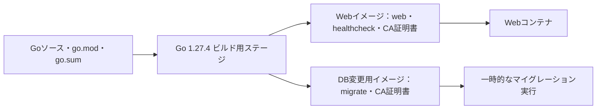
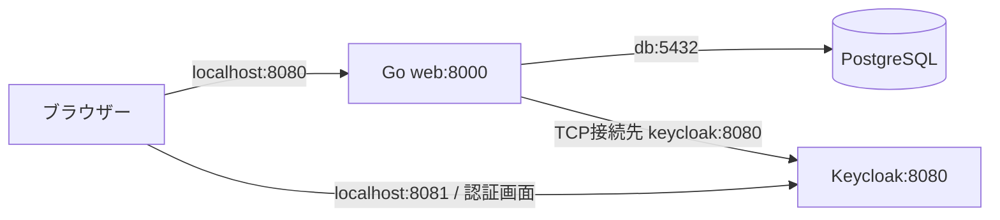

# Goアプリをコンテナで動かす

今回決めたこと：Goをコンテナ用にビルドし、Webとマイグレーションを別々に実行する。
採用理由：AWSへ載せる実行形式と通信経路を、先にローカルで確かめるため。
完了条件：コンテナからログイン・CRUD・所有者制限が動き、ログ・正常終了・再作成を確認できる。

## 起動

Docker Desktopを起動する。既にWSLでGoを動かしている場合はCtrl+Cで止める。ホストで動かすGoとWebコンテナは同じ8080番を使うため、同時には起動しない。

```bash
bash scripts/setup-local.sh
docker compose up -d --wait db keycloak
docker compose --profile app build web migrate
docker compose --profile app run --rm migrate up
docker compose --profile app up -d --wait web
```

[http://localhost:8080](http://localhost:8080)を開き、いつものAlice・Bobでログインする。既存のDBとKeycloakのボリュームを使うため、ユーザーや本を引き継ぐ。

`build`はGoのソースから実行用イメージを作る。`migrate up`はDBのテーブル変更、`up ... web`はWebの起動。Webの起動だけでマイグレーションを自動実行しない。適用済みなら `applied 0 migration(s)` になる。

DB接続は標準でTLS検証を要求するが、このローカルComposeだけ `DATABASE_REQUIRE_TLS=false` と `sslmode=disable` を指定する。AWS向けの接続方法は[DB TLS手順](database-tls.md)を参照。

`app`はComposeのプロファイル名。Webとmigrateを使いたいときに指定する。従来の「DBとKeycloakをCompose、GoをWSLで実行」も選べる。

## 追加したファイルと役割

| ファイル | 役割 |
| --- | --- |
| `Dockerfile` | Goをビルドし、Web用とDB変更用のイメージを作る。RDS CAのハッシュを確認して同梱 |
| `.dockerignore` | ビルドに渡すファイルをソース・依存定義に限定する |
| `compose.yaml` のweb / migrate | ローカルの接続先、起動順、ポート、実行制限 |
| `cmd/healthcheck/main.go` | curlやシェルを入れずに `/healthz` を確認する小さな実行ファイル |
| `internal/auth/transport.go` | ローカル開発時に、OIDCのTCP接続先だけをコンテナへ向ける |
| `internal/auth/transport_test.go` | 接続先を変えてもトークン検証が残り、HTTPS環境では開発用設定を拒否することを確認 |

## イメージの設計



| 判断 | 理由・トレードオフ |
| --- | --- |
| Go公式イメージでビルド、scratchで実行 | SDKやシェルを実行用イメージへ含めず、小さくする。コンテナ内でシェルを開いて調べる方法は使えない |
| Go 1.27.4・ベースイメージdigestを固定 | 手元のSDKと揃え、同じビルド元を指定する。更新は固定値の変更と再検証が必要 |
| Webとmigrateを別イメージにする | Webの起動とDB変更を別の操作として扱える。AWSでの実行権限分離へつなげる |
| UID/GID 65532で実行 | rootを使わず、8000番で待ち受ける |
| root filesystemを読み取り専用、capabilitiesを全削除 | アプリに不要な書き込み・OS操作の権限を減らす。ファイル保存機能を追加するときは見直す |
| 秘密情報は起動時の環境変数 | イメージやビルド引数にパスワードを入れない。ローカルではComposeが必要な値だけ渡す |

Goは `CGO_ENABLED=0` でビルドする。HTTPS接続に使うCA証明書を実行用へコピーする。現時点ではlinux/amd64を実機確認した。ARM64の動作とRDS用証明書・TLS設定はAWS構成を作る段階で確認する。

マルチステージビルドでは、最終ステージに必要な成果物だけをコピーできる。[Docker公式](https://docs.docker.com/build/building/multi-stage/)

`.dockerignore`は許可したものだけを送る方式。`.env`・`.git`・`.cache`・`.tools`・バックアップ・ログ・文書はビルドコンテキストへ送らない。`docker compose config`やコンテナのinspect全体には実行時の秘密情報が出るため、設定の構文確認には `docker compose --profile app config --quiet` を使う。

## 通信経路とOIDC



Composeの同じネットワーク内では、サービス名で相手へ接続できる。DBへの接続先を `127.0.0.1` から `db:5432` へ変更した。[Docker公式：Compose networking](https://docs.docker.com/compose/how-tos/networking/)

OIDCには2種類のURLの使い方がある。

- ブラウザーとトークン検証が使うissuer：`http://localhost:8081/realms/reading-log`
- コンテナから実際にTCP接続する相手：`keycloak:8080`

Webコンテナ内のlocalhostはWeb自身を指すため、そのままではKeycloakへ接続できない。そこでComposeのwebだけに `OIDC_LOCAL_ADDRESS=keycloak:8080` を渡す。GoのHTTP Transportが、設定したissuerのホスト・ポートへ接続するときだけTCPの宛先を変更する。URL・HTTP Host・認証画面へのリダイレクト先・期待するissuerは変えない。

discovery・トークン交換・公開鍵の取得はこの接続経路を通り、署名・issuer・audience・nonce・PKCEなどの検証は既存処理を使う。Keycloak側の固定hostnameも維持する。[Keycloak公式：hostname](https://www.keycloak.org/server/hostname)、[Go公式：HTTP Transport](https://pkg.go.dev/net/http#Transport)

この補助はローカルHTTPの開発だけで有効。接続先は `keycloak` またはループバックIPとポートに制限する。APP_BASE_URLやOIDC_ISSUERがHTTPSなのにこの設定を渡すと、起動時にエラーになる。AWSではこの環境変数を渡さず、CognitoのHTTPSへ通常通り接続する。

ホストネットワークの共有やローカルDNSの書き換えも候補だが、今回は通常のComposeネットワークでDB・Webを分け、ブラウザーのURLと既存ユーザー識別子を保つ構成にした。

## 確認とログ

```bash
docker compose --profile app ps
curl -i http://localhost:8080/healthz
curl -i http://localhost:8080/readyz
docker compose --profile app logs --tail 50 web
docker compose --profile app run --rm migrate status
python3 scripts/verify-login.py
```

`/healthz`はGoの稼働、`/readyz`はDBへの接続確認。コンテナのhealthcheckは `/healthz` を使う。`healthy`だけで全依存先が正常と判断しない。将来のALBでは `/readyz` を使う案とする。

ログはGoの標準出力をDockerが受け取る。`database_connected`、`oidc_connected`、`server_started`を起動時に確認し、操作は `request_id` で追う。確認箇所はホスト実行時と同じ。

| 状況 | 確認するもの |
| --- | --- |
| 8080番が使用中 | WSL側のGoアプリが起動したままでないか |
| `database connection failed` | dbのhealthy状態、APP_DB_PASSWORDと初期化済みDBのパスワード |
| `OIDC discovery failed` | Keycloakのhealthy状態、OIDC_ISSUER、webのOIDC_LOCAL_ADDRESS |
| ログインでredirect URIエラー | APP_BASE_URLとKeycloakクライアントのredirect URI |
| コンテナはhealthyだがログインできない | DBマイグレーションの適用状況、認証のreasonログ |

実ブラウザーのCRUD検証は既存の `scripts/verify-books.py` を使える。[読書タスクの検証コマンド](reading-tasks.md#自動検証)を参照。

## 停止・再作成・削除

```bash
# Webだけを止める。GoがSIGTERMを受け、処理を終えて正常終了する
docker compose --profile app stop web

# 新しいイメージを作り、Webコンテナを作り直す
docker compose --profile app build web migrate
docker compose --profile app up -d --wait web

# 停止済みWebコンテナを削除する
docker compose --profile app rm web
```

Webの中にはユーザーデータを保存しない。セッションと本はPostgreSQLにあるため、Webを再作成しても引き継ぐ。強制的に再作成して試す場合は `up -d --force-recreate --wait web` を使う。

WSLでGoを動かす方式へ戻す場合は、webを停止してから `bash scripts/dev.sh run -buildvcs=false ./cmd/web` を実行する。`.env` の接続URLはホスト用のままなので、書き換えは不要。

DBとKeycloakも止める場合は `docker compose --profile app stop`。コンテナとネットワークを片付ける場合は `docker compose --profile app down`。データを残すときは `-v` を付けない。Webイメージが不要になったら、関連コンテナを削除した後に `docker image rm readinglog:local readinglog-migrate:local` で削除できる。

Composeはローカル用。ECRへのpush、ECS・ALB・RDS・Cognito・Secrets Managerの設定、AWS上の動作確認は後続のTerraformと実展開で行う。
