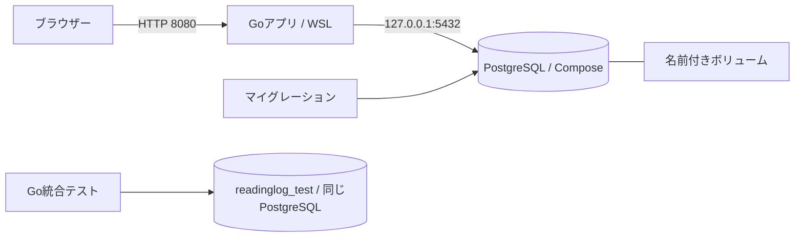

# ローカルPostgreSQL

## 今回の判断

決めること：PostgreSQLをComposeで動かし、Goから接続し、SQLでテーブル変更を管理する。

採用理由：SQLと接続・変更履歴の関係を確認しやすくするため。接続は標準の `database/sql` にpgxドライバーを組み合わせ、マイグレーションはgooseを組み込んだ小さなコマンドで行う。ORMと別途インストールするマイグレーションCLIは使わない。

完了条件：初回適用・再適用、テーブルの制約、コンテナ再作成後の永続化、DB停止・復旧時の応答を確認できる。

DBはPostgreSQL 18.6、ドライバーとgooseのバージョンは `go.mod` / `go.sum` で固定。AWSで使うRDSのバージョンは展開前に対応状況を確認する。

## 構成



| テーブル | 役割 |
| --- | --- |
| `users` | OIDCのissuerとsubjectの組を内部ユーザーIDへ対応づける |
| `sessions` | セッションIDのSHA-256ハッシュ、ユーザー、期限を保持する |
| `reading_tasks` | ユーザーごとの書名・状態・メモを保持する |
| `login_requests` | ログイン途中のstate・ブラウザーのハッシュ、nonce、PKCE verifierを保持する |
| `goose_db_version` | SQLの適用履歴を管理する |

ステップ3でログイン・セッション失効と期限確認、ステップ4で[タスク操作時の所有者確認](reading-tasks.md)を実装した。`updated_at` はアプリの更新SQLから更新する。

アプリとマイグレーションは専用ロール `readinglog` を共用する。スーパーユーザー権限・DB作成・ロール作成権限は付けない。ローカル開発用の対象スキーマは所有するため、テーブルを変更・削除できる。実行用と変更用の権限分離は後の拡張とする。

## 起動とマイグレーション

```bash
bash scripts/setup-local.sh
docker compose up -d --wait db keycloak
bash scripts/dev.sh run -buildvcs=false ./cmd/migrate status
bash scripts/dev.sh run -buildvcs=false ./cmd/migrate up
bash scripts/dev.sh run -buildvcs=false ./cmd/web
```

空のDBでの最初の `up` は、現在のSQL2ファイルを適用して `applied 2 migration(s)`、同じSQLの再実行は `applied 0 migration(s)`。アプリ起動時には自動適用しない。SQLはバイナリに埋め込み、適用中はPostgreSQLのアドバイザリロックで他のマイグレーション実行と競合しないようにする。

適用済みSQLの書き換えではなく、次の変更は `migrations/00003_名前.sql` のような新しいファイルに追加する。通常の操作は `up` と `status`。初期SQLのDown節はテーブルを削除するため、今回のコマンドには公開していない。

## 設定と接続

初回に生成する `.env` は所有者だけが読み書きでき、Git管理対象外。`scripts/dev.sh` はシェル設定として読み込むため、自分で生成・編集したものを使う。既存の値は保持し、不足する設定だけ追加する。

DBの公開先は `127.0.0.1` に限定する。接続URLの `sslmode=disable` はこのローカル開発専用。RDS接続ではTLSと証明書検証を設定する。

`DB_PORT` を変更するときは `DATABASE_URL` と `TEST_DATABASE_URL` のポートも変更する。パスワードの初期設定と `docker/postgres/init-app.sh` は空のボリュームで初期化するときだけ実行される。既存DBのパスワードを変える場合はDB側の変更も必要で、`.env` の編集だけでは反映されない。

## 確認と障害調査

```bash
docker compose ps
docker compose logs --tail 50 db
bash scripts/dev.sh run -buildvcs=false ./cmd/migrate status
curl -i http://localhost:8080/healthz
curl -i http://localhost:8080/readyz
```

DB内のテーブルを確認する場合：

```bash
docker compose exec db bash -c 'PGPASSWORD="$APP_DB_PASSWORD" psql -h 127.0.0.1 -U readinglog -d readinglog'
```

psqlで `\dt` を入力するとテーブル一覧、`\q` で終了する。パスワードや接続URLをログ・スクリーンショット・Gitへ含めない。`docker compose config --quiet` なら値を表示せず設定だけ検証できる。

| 状況 | 確認箇所 |
| --- | --- |
| Dockerへ接続できない | Docker Desktopの起動、WSL integration。ソケット権限を緩める必要はない |
| 5432番が使用済み | 既存DBの有無。`.env` のポートと接続URLを揃えて変更 |
| アプリが起動しない | `DATABASE_URL`、Composeの状態、DBのログ。起動時に5秒の接続確認を行う |
| `/readyz` が503 | アプリの `database_unavailable` と同じ `request_id` の `http_request`、DBの状態とログ |
| テーブルがない | `migrate status` のpending表示。`migrate up` を実行 |

アプリ起動後に `docker compose stop db` を実行すると `/readyz` は503、`/healthz` は200になる。`docker compose up -d --wait db` で再開すると、アプリを再起動せず `/readyz` が200へ戻る。

## テスト

```bash
bash scripts/go.sh test ./...
bash scripts/go.sh vet ./...
bash scripts/dev.sh test ./...
```

`TEST_DATABASE_URL` がない実行ではDB統合テストをスキップする。`dev.sh` で設定を読み込むと、専用DB `readinglog_test` の一時スキーマ内で実際のSQLを実行する。テスト後にそのスキーマを削除する。接続先のDB名が異なる場合はテストを中断する。

## 停止・再作成・削除

| 操作 | コマンド | データ |
| --- | --- | --- |
| 停止 | `docker compose stop db` | 残る |
| 再開 | `docker compose up -d --wait db` | 残る |
| DBコンテナの再作成 | `docker compose up -d --force-recreate --wait db` | ボリュームから引き継ぐ |
| コンテナとネットワークの削除 | `docker compose down` | ボリュームは残る |
| DBデータも初期化 | `docker compose down -v` | **PostgreSQLとKeycloakの両方の名前付きボリュームを削除する** |

普段は停止だけでよい。データを捨ててよい場合だけ最後の操作を使い、その後の `up` で再初期化してマイグレーションを適用する。`.env` は削除されない。ボリュームの永続化はバックアップではないので、バックアップと別DBへの復元はステップ5で試す。

## 公式資料

2026-11-12確認。

- [PostgreSQL公式コンテナ](https://hub.docker.com/_/postgres)：初期化と、18以降のボリューム配置先 `/var/lib/postgresql`。
- [pgxのdatabase/sqlドライバー](https://pkg.go.dev/github.com/jackc/pgx/v5/stdlib)
- [goose Provider](https://pressly.github.io/goose/documentation/provider/)
