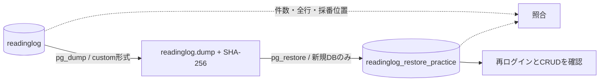

# ローカルの障害調査とバックアップ・復元

今回決めたこと：DB停止時の切り分けと、アプリDBを別DBへ戻す方法。
採用理由：ログで原因を絞り、復元後にログイン・業務操作まで動くことを確認するため。
完了条件：DB停止・回復をrequest_idで追跡でき、復元先の件数・所有者・内容が一致し、2ユーザーで操作できる。

## 何を用意したか

| ファイル | 役割 |
| --- | --- |
| `scripts/local-db.py` | バックアップ、別DBへの復元、内容照合、復元DBの削除 |
| `scripts/verify-operations.py` | DB停止から復元後のアプリ操作までを実際に検証 |
| `.cache/backups/` | バックアップとSHA-256。Git管理対象外 |
| `.cache/verification/05-operations-*/` | 自動検証のJSONログと結果。Git管理対象外 |

Python標準ライブラリと既存のComposeを使う。`pg_dump` / `pg_restore` / `psql` はDBコンテナ内のものを使うので、ホストへ追加インストールしない。アプリのGoコードは変更していない。

## ログから障害を調べる

アプリを起動し、Aliceとしてログインしておく。標準出力へJSONログが出る。

```bash
bash scripts/dev.sh run -buildvcs=false ./cmd/web
```

別のターミナルからローカルDBを一時停止して、応答を見る。

```bash
docker compose stop db
curl -i http://localhost:8080/healthz
curl -i http://localhost:8080/readyz
docker compose ps --all
docker compose logs --tail 30 db
```

| 観測 | 意味 |
| --- | --- |
| `/healthz` が200 | GoのHTTPサーバーは動いている |
| `/readyz` が503 | DB接続が使えない |
| ログイン済みのブラウザーで本棚が503 | セッションをDBで確認できず、操作を止めている |
| ComposeのdbがExited | 今回はDBコンテナの停止が原因 |

未ログインで `/books` を開くとトップへ戻るため、障害中の本棚の確認にはログイン済みのブラウザーを使う。

レスポンスヘッダーの `X-Request-ID` と、JSONログの `request_id` を一致させる。`/readyz` では `database_unavailable`、本棚では `session_unavailable` が同じIDで記録される。本棚のSQLより先にセッションの確認で失敗している、と分かる。ログにはCookie・パスワード・本文を出さない。

```bash
docker compose up -d --wait db
curl -i http://localhost:8080/readyz
```

DBがhealthyになれば200へ戻る。アプリを再起動せず、同じブラウザーで本棚を表示できる。200へ戻らなければDBの状態・接続設定・ログを続けて調べる。`/readyz` はDB接続の確認で、全テーブルやKeycloakの正常性までは確認しない。

## バックアップと復元の方針



| 判断 | 理由・トレードオフ |
| --- | --- |
| `pg_dump`のcustom形式 | テーブル定義・データ・採番情報をまとめて保存でき、pg_restoreで復元できる。ローカルの小さなDBに適する |
| 新しいDBだけに復元 | 元のDBを残して比較・切り戻しできる。復元分の領域が必要 |
| `sessions` / `login_requests`の行を除外 | 古いセッションや認証途中の状態を復活させない。復元後は再ログインが必要。テーブル定義は残す |
| `--no-owner` / `--no-acl` | 既存のアプリ用ロールへ復元する。DBロール・権限の再作成はこのファイルに含めない |
| `--single-transaction` | 途中で失敗したら復元の変更を確定させない。小さなDB向けの単純な方法 |
| ローカル保存・手動実行 | まず復元手順を理解する。自動保持期限・暗号化保管・別の場所への複製は今回の範囲外 |

`pg_dump`は単一DBの整合したバックアップを作る。稼働中にも取得できるが、今回の元DBとの照合では取得後の変更と復元ミスを区別するため、Goアプリなどからの書き込みを止める。[PostgreSQL公式：pg_dump](https://www.postgresql.org/docs/18/app-pgdump.html)

`pg_restore`では既存DBを消す `--clean` と、アーカイブ内の元DB名へ接続する `--create` を使わない。単一トランザクションで復元し、成功後にANALYZEする。[PostgreSQL公式：pg_restore](https://www.postgresql.org/docs/18/app-pgrestore.html)

## 手元でバックアップ・照合する

GoアプリをCtrl+Cで止め、DBへの他の書き込みも止める。DBコンテナ自体は起動しておく。プロジェクトのディレクトリで実行する。

```bash
backup_file="$(python3 scripts/local-db.py backup)"
python3 scripts/local-db.py restore "$backup_file" readinglog_restore_practice
python3 scripts/local-db.py compare readinglog_restore_practice
```

`backup`は `.cache/backups/<UTC日時と識別子>/readinglog.dump` と、その隣に `readinglog.dump.sha256` を作る。ディレクトリは700、ファイルは600。ダンプは暗号化されておらず、ユーザー識別子や書名・メモを含む。両ファイルを一組で扱い、Gitへ追加しない。

`restore`はチェックサムとアーカイブを確認してから新しいDBを作る。復元先は `readinglog_restore_` に英小文字・数字・アンダースコアを1〜40文字続けた名前だけを許可する。既存DBへの復元はエラーになり、上書きしない。復元途中で失敗した場合は、その実行で新規作成したDBだけを削除する。接続中などで削除できない場合はDB名を表示する。

チェックサムはファイルの破損確認用で、作成者の署名ではない。自分のこの環境で作成したバックアップを使う。

`compare`はユーザー・読書タスク・gooseの履歴の全列（所有者、本文、日時を含む）と採番位置を比較する。内容は表示せず、件数とハッシュだけを出す。復元先の認証用2テーブルが空であることも確認する。取得後に元DBを更新すると不一致になるため、比較はアプリを再開する前に行う。

DBの作成・削除だけはローカル管理者ロール、ダンプ・復元・照合は `readinglog` ロールで行う。対象はこのComposeの `readinglog` DBに固定してあり、`.env` の `DATABASE_URL` を変更してもバックアップ元は変わらない。

## 復元したDBをアプリで確認する

照合後、Goアプリを止めた状態で、ローカル `.env` の `DATABASE_URL` のDB名部分だけを `/readinglog` から `/readinglog_restore_practice` に変更して起動する。接続先のホスト・パスワード・クエリ設定はそのままにする。

1. 元のログインCookieではトップへ戻る。Alice・Bobでそれぞれログインし直す。
2. 自分の本が表示され、他人のIDでは404になることを確認する。
3. 追加・編集・削除を試す。この操作は復元先のDBへ保存される。
4. Goを停止し、`.env` のDB名を必ず元の `/readinglog` に戻してから起動する。

Keycloakは既存のものを使う。バックアップはアプリDBだけで、Keycloakのユーザー・鍵・設定、`.env`、DBロールは含めない。Keycloakを初期化するとissuer/subjectの対応が変わるため、このバックアップだけで同じアカウントとして復旧できるとは限らない。

## 自動で一連の演習を行う

Goアプリを停止してから実行する。DBとKeycloakは起動済み、アプリURLは `http://localhost:8080` のローカル設定を前提とする。

```bash
docker compose up -d --wait db keycloak
bash scripts/go.sh build -o bin/readinglog ./cmd/web
python3 scripts/verify-operations.py
```

検証はアプリを自分で起動し、DBを一時停止・再開する。4冊の検証データを作ってバックアップし、復元・比較・古いCookieの拒否・2ユーザーでの操作まで試す。自動検証では `.env` は編集せず、子プロセスに渡す接続先だけを切り替える。

終了時は、この実行で作った本・セッション・認証途中の行と復元DBを削除し、Goを停止する。元DBとKeycloakは起動したまま。採番値は進むため、欠番は正常。バックアップとローカルの検証ログは残す。プロセスの強制終了やDocker自体の停止では後片付けが完了しない場合があるので、出力先とComposeを確認する。

## 片付けと今回の範囲

復元先へ接続するGoを止め、`.env` の接続先を元へ戻してから、対象を指定して削除する。

```bash
python3 scripts/local-db.py drop readinglog_restore_practice
```

元DB名やテスト用DB名は削除対象に指定できない。接続中のDBを強制削除するオプションも使わない。不要なバックアップは `.cache/backups/` の該当ディレクトリを選んで削除する。バックアップは自動削除しない。

復元で戻るのは取得時点のデータ。取得後の変更は戻らない。同じPC内のバックアップはPCやディスク全体の故障への備えにはならない。今回の結果はローカルの論理バックアップの検証であり、RDSのスナップショット・時点復元、別ホストへの復旧、Keycloakの復旧は後の作業とする。
