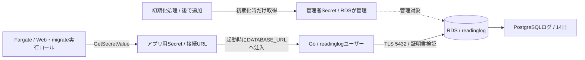

# RDSとSecrets Manager：DB・接続情報・バックアップ

更新日：2026-11-16（日本時間）

今回決めること：プライベートRDSの設定、管理者とアプリの認証情報の分離、バックアップと削除時の扱い。
採用理由：DBを公開せず、アプリへ管理者権限を渡さずに、再構築と復元を学べる構成にする。
完了条件：Terraform定義の構文・mockテストが通り、接続準備と復元・削除の手順を説明できる。

今回はAWS定義の追加まで。実AWSへのplan/apply、RDS起動、Secretの値の投入、復元演習は行っていない。クライアントTLS・CA同梱は[ステップ6E](database-tls.md)で実装/ローカル検証済み。アプリユーザー初期化とSecret値投入は後続。

## 作ったもの

| ファイル | 定義したもの |
| --- | --- |
| `infra/dev/database.tf` | DB用サブネットグループ、PostgreSQL設定、RDS、DBログの保存先 |
| `infra/dev/secrets.tf` | アプリの接続URL用Secretと、実行ロールの取得権限 |
| `infra/dev/variables.tf` | DB削除保護、最終スナップショット名、RDSでも使える名前の制約 |
| `infra/dev/outputs.tf` | DB接続先・SecretのARN・ログ名。パスワードの出力なし |
| `infra/dev/tests/database.tftest.hcl` | 配置・TLS・バックアップ・権限・削除設定の6件のmockテスト |

将来の実行時の関係。タスク・DBユーザー初期化・Secret値の投入は未実装。



SGは前回のDB用SGを使い、アプリSGからの5432番だけを受ける。DB用サブネットにはインターネット向けの経路がない。バックアップやRDSの管理処理のために、DBへNAT経路や広い送信ルールを追加することはしない。

## DB設定と選択理由

| 項目 | 初期設定 |
| --- | --- |
| DB識別子・DB名 | `reading-log-dev-db` / `readinglog` |
| エンジン | PostgreSQL 18.6、`postgres18`パラメーターグループ |
| 配置 | 東京・DB用2サブネットを指定、Single-AZ、公開アクセス無効 |
| サイズ | `db.t4g.micro`、暗号化gp3 20GiB、自動拡張の上限100GiB |
| 通信 | `rds.force_ssl = 1`、CAは `rds-ca-rsa2048-g1` |
| 自動バックアップ | 7日保持、毎日18:00〜18:30 UTC（翌日03:00〜03:30 JST） |
| 保守時間 | 日曜19:00〜20:00 UTC（月曜04:00〜05:00 JST） |
| 更新 | minor版もコードで指定し、自動minor更新は無効。通常の変更は保守時間へ回す |
| 削除 | 削除保護あり、最終スナップショット必須、自動バックアップも保持 |

18.6は確認日のRDS公式リリースノートにある版。東京でこの版・インスタンスクラスを作れるかは実展開前に確認する。ローカルPostgreSQLの版と揃えたが、RDS固有の権限・設定まで同一になるわけではない。[AWS：RDS PostgreSQLのリリース](https://docs.aws.amazon.com/AmazonRDS/latest/PostgreSQLReleaseNotes/postgresql-versions.html)

Single-AZは小さな学習環境に合わせた選択で、AZ障害時の自動フェイルオーバーは持たない。容量の自動拡張は上限を設けるが、増えた容量はそのまま縮められない。実展開時には稼働時間と容量上限を含めて見積もる。[AWS：RDSストレージ](https://docs.aws.amazon.com/AmazonRDS/latest/UserGuide/CHAP_Storage.html)

バージョンを固定する代わりに、自分でRDSの更新情報を確認し、復元先などで動作を確かめてから `engine_version` を更新する。自動の有償延長サポートは無効とし、サポート終了前にメジャー更新を計画する。バックアップと保守の時間を分け、変更の即時適用は既定で無効にする。

`rds.force_ssl` は平文接続を拒否する設定で、Goによるサーバー証明書検証とは別。既存DBへパラメーターグループを変える場合は再起動・反映状態も確認する。[AWS：PostgreSQLのTLS](https://docs.aws.amazon.com/AmazonRDS/latest/UserGuide/PostgreSQL.Concepts.General.SSL.html)

DBログは `/aws/rds/instance/reading-log-dev-db/postgresql` へ送り、14日保持する。[AWS：DBログのCloudWatch送信](https://docs.aws.amazon.com/AmazonRDS/latest/UserGuide/USER_LogAccess.Procedural.UploadtoCloudWatch.html)SQL本文を通常記録しないよう `log_statement=none`、`log_min_duration_statement=-1`、`log_min_error_statement=panic` を指定する。SQL本文を記録しない分、クエリ調査の材料は減る。エラーメッセージやDETAILにも値が含まれる場合があるため、ログ全体の秘匿を保証する設定とは扱わず、実機で内容を確認する。[PostgreSQL：ログ設定](https://www.postgresql.org/docs/18/runtime-config-logging.html)

## 2つの認証情報を分ける

| 対象 | 管理方法 | 用途 |
| --- | --- | --- |
| `readinglog_admin` | RDSがパスワードを生成し、管理対象のSecretへ保存 | DBユーザー初期化・管理作業だけ |
| `readinglog` | 初期化時に作る予定。接続URLを `reading-log-dev/database-url` へ保存 | Webとマイグレーション |

RDSには `manage_master_user_password = true` を指定し、Terraformの `password` や `random_password` は使わない。管理者の値はTerraformで取得せず、ARNだけ参照する。RDSが生成するSecretはRDSの管理対象で、DBを削除するとこのSecretも削除される。[AWS：RDSによるパスワード管理](https://docs.aws.amazon.com/AmazonRDS/latest/UserGuide/rds-secrets-manager.html)

アプリ用Secretは保存先だけをTerraformで作る。`aws_secretsmanager_secret_version` やSecret値を読み出すdata sourceは作らない。実値をTerraformへ渡さないことで、この構成では接続パスワードをstateへ入れない。state自体は引き続き保護対象として扱う。

初期構成ではWebとmigrateが同じ専用DBユーザーを使う。スーパーユーザー・ロール作成・DB作成は許可せず、対象スキーマを所有させる方針。WebからもDDLができるトレードオフが残るため、実行用と変更用のDB権限分離は後の拡張にする。

両方のECS実行ロールへ、アプリ用SecretのARNに限定した `secretsmanager:GetSecretValue` だけを追加する。管理者Secretの取得・Secret更新・一覧取得は許可に含めない。Go用タスクロールへのAPI許可も追加しない。初期はSecrets Managerの既定のAWS管理キーを使い、カスタマー管理KMSキーを使う場合の権限追加は別途設計する。

## 次に実装する接続準備

1. RDSの公式CAバンドルを検証して、Web・migrateイメージへ含める（ステップ6Eで完了）。
2. プライベート側で実行する初期化処理を用意する。管理者Secretを読む権限はこの処理だけへ与え、アプリユーザーと対象スキーマの権限を作る。
3. URLのユーザー名・パスワードを適切にエンコードし、アプリ用Secretへ接続URLの文字列全体を保存する。値をコマンド引数・ログ・Gitへ出さない。
4. ECSタスク定義の `secrets` で、このSecretの全文を `DATABASE_URL` に注入する。
5. 専用ユーザーでマイグレーション、Webの起動、TLSと認可を確認する。

接続URLの予定形式（実値ではない）：

```text
postgres://readinglog:<URLエンコード済みパスワード>@<RDSエンドポイント>:5432/readinglog?sslmode=verify-full&sslrootcert=/app/certs/ap-northeast-1-bundle.pem
```

このCAは現在のWeb/migrateイメージに同梱済み。Goは `DATABASE_REQUIRE_TLS` が未設定またはtrueなら証明書・ホスト名検証を要求する。実RDSへの接続確認は後日行う。Secretに値がないままでは、将来のECSタスクは起動できない。[AWS：RDSのCA](https://docs.aws.amazon.com/AmazonRDS/latest/UserGuide/UsingWithRDS.SSL.html)

Secretの更新だけでは、すでに起動したタスクの環境変数は変わらない。アプリDBパスワードの変更はDB側・Secret側・タスクの再起動を一組として扱う。管理者用のRDS自動ローテーションがアプリユーザーまで更新するわけではない。[AWS：ECSへのSecret注入](https://docs.aws.amazon.com/AmazonECS/latest/developerguide/secrets-envvar-secrets-manager.html)

## ローカル検査と調査先

```bash
bash scripts/check-terraform.sh
```

期待結果は `Success! 18 passed, 0 failed.`。実AWSの作成や認証は行わず、管理者SecretのARNも架空値を使う。検査は設定の対応関係を見るもので、RDSのTLS・実IAMの拒否・復元成功を証明するものではない。[検証結果](../verification/09-rds-and-secrets.md)

| 症状・確認事項 | 実展開後に見る場所 |
| --- | --- |
| DBへ接続できない | RDS状態・エンドポイント、DB用SG、アプリ側の `database connection failed` |
| TLS接続が失敗する | `rds.force_ssl` の反映状態、クライアントのCA・ホスト名・verify-full |
| 起動時にSecret取得が失敗する | ECS停止理由、実行ロールの対象ARN、SecretにAWSCURRENTの値があるか |
| DB内部のエラー | PostgreSQLロググループ、RDSイベント |
| 復元できる時点 | RDSの自動バックアップ、Earliest/Latest restorable time、スナップショット状態 |

## 後日の復元演習

1. 検証用の本を登録し、件数・所有者・採番・時刻を記録する。手動スナップショットがavailableになるまで待つ。
2. 元DBを残したまま、別のDB識別子へ復元する。DB用サブネット、検証用接続元だけのSG、公開無効、今回のパラメーターグループを明示する。元アプリの接続先は変更しない。
3. 復元先の管理者認証情報を整える。PostgreSQLではスナップショット/PITRの復元要求に管理パスワード設定をそのまま付ける設計にせず、復元後のDB変更でRDS管理を有効化し、取得した新しいSecretを使う。公式仕様と実機で再確認する。
4. RDSスナップショットにはセッション行も含まれる。復元先だけの `sessions` / `login_requests` を消して再ログインさせ、接続先とアプリパスワードを確認する。復元用Secretを作り、検証タスクだけへ渡す。
5. TLS接続、マイグレーション状態、件数・所有者・採番、ログイン・CRUD・他人の本の拒否を確認し、復元所要時間を記録する。
6. 続けて、バックアップ期間内の指定時刻へ別インスタンスを復元するPITRも試す。検証後は復元用タスク・DB・Secret・検証用SGを片付ける。

スナップショットもPITRも既存DBへの上書きではなく新しいDBへの復元。[AWS：スナップショット復元](https://docs.aws.amazon.com/AmazonRDS/latest/UserGuide/USER_RestoreFromSnapshot.html)、[AWS：PITR](https://docs.aws.amazon.com/AmazonRDS/latest/UserGuide/USER_PIT.html)

復元用リソースをTerraformの本体設定の書き換えで代用しない。実施時は検証用の管理単位を用意し、残す場合のimportと削除対象も記録する。復元演習・初期化処理は現在未実装/未実施。

## 再構築と削除

ローカル検査環境は従来のsetup/checkスクリプトで再作成できる。AWS展開はstate基盤・接続準備・料金確認が揃った後に行う。

実AWSの削除前には、必要なログ・Secretの扱い・復元方法を確認する。既存スナップショットと衝突しない `db_final_snapshot_identifier` を設定し、`db_deletion_protection = false` への変更を先にplan/applyしてから削除planへ進む。削除保護はRDS単体の設定で、他リソースの削除まで止めるものではない。

| 削除後の対象 | 今回の方針 |
| --- | --- |
| 最終/手動スナップショット | 残す。不要になった時点で明示的に削除 |
| 自動バックアップ | 削除時の保持期間に従って残す。永久保存ではない |
| RDS管理者Secret | RDSの削除に伴って削除される |
| アプリ用Secret | 7日間の復旧猶予を付けて削除予約。予約中も値は取得できない |
| DBロググループ | 環境とともに削除。必要な記録は先に退避 |

復旧猶予中のSecretは同じ名前で作り直せないため、再構築では復旧してimportするか、別の環境名を使う。削除後もスナップショット・保持バックアップ等を確認し、料金が残る対象を記録する。[AWS：RDS削除](https://docs.aws.amazon.com/AmazonRDS/latest/UserGuide/USER_DeleteInstance.html)、[AWS：Secret削除](https://docs.aws.amazon.com/secretsmanager/latest/userguide/manage_delete-secret.html)
