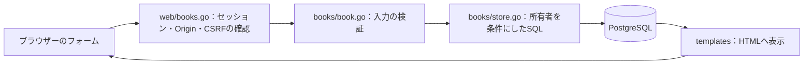

# 読書タスクの操作と調査

今回決めたこと：書名・状態・メモを扱う画面と、所有者ごとのアクセス制御。
採用理由：ログインした人が自分のデータだけ操作できる、最小のアプリを完成させる。
完了条件：CRUD、他人のIDの拒否、フォーム改ざんの拒否をGo・実DB・ブラウザーで確認する。

## 起動して触る

[README](../../README.md#起動)の手順でDB・Keycloak・Goを起動し、[アプリ](http://localhost:8080)を開く。

1. `alice` でログイン。パスワードはローカル `.env` の `LOCAL_USER_PASSWORD`。
2. 「本を追加」から書名・状態・メモを入力し、「追加」。詳細画面のURLを控える。
3. 「編集」で状態やメモを変更して「保存」。一覧は更新が新しい順に並ぶ。
4. 別ブラウザーまたはプライベートウィンドウで `bob` としてログインする。Aliceの本は一覧に出ず、控えたURLも404になる。
5. Aliceの画面で「削除」を押す。「キャンセル」では残り、「削除する」で初めて消える。

一覧は20件ずつ。「次へ」「前へ」で移動する。書名は前後の空白を除いて1〜300文字、メモは任意で10,000文字まで。状態は「未読・読書中・読了」の3種類。文字数はUnicodeのコードポイント数なので、結合文字を含む一部の絵文字は見た目の1文字と一致しない。

## 処理の流れとファイル



| ファイル | 作ったもの・役割 |
| --- | --- |
| `internal/books/book.go` | 1冊分のデータ、書名・状態・メモの入力ルール |
| `internal/books/store.go` | DBへの追加・一覧・取得・更新・削除。すべてにユーザーIDを渡す |
| `internal/web/books.go` | URLからの入力を確認し、DB操作と画面表示をつなぐ |
| `internal/web/handler.go` | 各URLを処理へ結び付ける |
| `internal/web/templates/` | 本棚、追加・編集、詳細、削除確認、エラー画面と共通ヘッダー |
| `internal/web/static/app.css` | 一覧・フォーム・スマートフォン幅のレイアウト |
| `internal/books/*_test.go` / `internal/web/books_test.go` | 入力、実DBの所有者制限、HTTPでの改ざん・CSRF・表示の検証 |
| `scripts/verify-books.py` | 実Keycloakへ2ユーザーでログインし、ブラウザーから操作・拒否を確認 |

既存の `reading_tasks` テーブルを使うため、新しいマイグレーションは不要。

| HTTP | URL | 動作 |
| --- | --- | --- |
| GET | `/books` / `/books?page=2` | 自分の本を一覧表示 |
| GET / POST | `/books/new` / `/books` | 追加画面 / 追加の実行 |
| GET | `/books/{id}` | 詳細 |
| GET / POST | `/books/{id}/edit` / `/books/{id}` | 編集画面 / 更新の実行 |
| GET / POST | `/books/{id}/delete` | 削除確認 / 削除の実行 |

## 認可と入力の判断

認証は「誰か」を確認し、認可は「その本を操作してよいか」を確認する。ログイン済みでも、所有者が違えば操作できない。

```sql
UPDATE reading_tasks SET title=$3, status=$4, notes=$5, updated_at=now()
WHERE user_id=$1 AND id=$2;
```

`$1` はサーバーがDBセッションから取得したユーザーID。フォームには所有者の入力欄を置かず、`user_id` を追加して送っても400で拒否する。取得・更新・削除のSQLには、常に所有者と本のIDを両方指定する。先に画面を隠すだけではなく、DB操作そのものを制限する。他人の本と存在しない本は同じ404にする。

| 判断 | 採用理由とトレードオフ |
| --- | --- |
| Goで所有者をSQL条件に含める | 処理を追いやすく、学習しやすい。DBのRow Level Securityは使わないため、新しい操作でも条件を忘れないようテストする |
| サーバーでHTMLを生成する | 画面とGoの関係が単純。SPAやJavaScriptのビルド環境は追加しない |
| POST + Origin + CSRFトークン | 外部サイトからの変更要求と、正規セッションのトークンがない要求を拒否。GETではDBを変更しない |
| 20件単位のページ表示 | 大きな一覧やメモ全文を一度に読まない。ページ番号方式なので、別タブで更新するとページ間の並びが変わり得る |
| 同時編集は後に保存した内容を採用 | 個人利用の最小版として実装を小さくする。複数タブの更新競合の検出は未実装 |

フォームは許可された項目だけ、各項目1個だけを受け付ける。変更要求のクエリ指定、重複項目、128KiBを超える本文、不正なContent-Typeも拒否する。文字数や状態のエラーは422でフォームへ戻し、入力内容を保持する。HTMLは `html/template` でエスケープし、SQLの値はプレースホルダーで渡す。

## 自動検証

```bash
# 実DBのテストを含む。DBを起動しておく
bash scripts/dev.sh test ./...
bash scripts/go.sh vet ./...

# アプリ・DB・Keycloak起動後、既存の認証経路も確認
python3 scripts/verify-login.py
```

ブラウザー検証は任意。PlaywrightとChromiumがあるPython環境で `python scripts/verify-books.py` を実行する。この作業環境では既存のローカル配置を使える。

```bash
FONTCONFIG_FILE="$PWD/.tools/browser-fonts.conf" \
LD_LIBRARY_PATH="$PWD/.tools/browser-libs/usr/lib/x86_64-linux-gnu" \
PLAYWRIGHT_BROWSERS_PATH=.cache/playwright \
.tools/browser/bin/python scripts/verify-books.py
```

GoのDBテストは `readinglog_test` の一時スキーマを作り、終了時に削除する。ブラウザー検証はアプリ用DBに検証用の本を作り、返されたIDの本だけを最後に削除・ログアウトする。画像は `.cache/verification/04-*.png` に保存する。強制終了した場合は作成済みの検証用の本が残り得るため、該当ユーザーの画面から確認して削除する。

## ログの見方

アプリを起動したターミナルのJSONログを見る。レスポンスの `X-Request-ID` とログの `request_id` を照合する。

| イベント・状態 | 確認する箇所 |
| --- | --- |
| `book_created` / `book_updated` / `book_deleted` | 操作した `user_id`、対象の `book_id`、同じrequest_idのHTTP応答 |
| `book_not_found` / 404 | 自分の本のURLか、削除済みでないか。他人の本でも同じ応答 |
| `book_request_rejected` / 400・403・413・415 | `reason`。`invalid_csrf`、`invalid_origin`、`unexpected_field`、`unexpected_query`、`invalid_body`、`invalid_content_type`など |
| 422 | 入力欄に出るエラー。書名・メモの長さと状態を確認 |
| `session_unavailable` / `book_store_failed` / 503 | `docker compose ps`、DBログ、`/readyz`、マイグレーション状態。接続確認が通ってもテーブルの不足はあり得る |

書名・メモ・Cookie・CSRFトークン・DBエラー全文はログへ出さない。HTTPログにもフォーム本文やクエリ文字列を入れない。[障害調査とバックアップ・復元の手順](local-operations.md)で実際の演習もできる。
