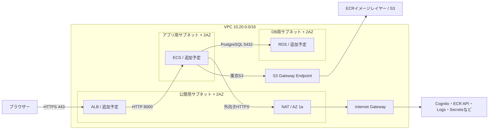

# Terraform：ネットワークの定義とローカル検査

更新日：2026-11-16（日本時間）

今回決めること：東京の2AZに、公開用・アプリ用・DB用のネットワークを分ける。
採用理由：アプリとDBをプライベートに置き、通信経路と許可する相手をコードで確認できるようにする。
完了条件：構文検証とmockテストが通り、通信経路・再実行方法を説明できる。AWSリソースはまだ作成しない。

## 定義したもの

Terraformは「作りたいAWS構成」を記述するツール。今回は `infra/dev/` にネットワークを定義した。同じディレクトリの `.tf` はまとめて1つの構成として読み込まれる。学習用の単一環境なので、最初からモジュールへ分割しない。

| ファイル | 役割 |
| --- | --- |
| `versions.tf` / `.terraform.lock.hcl` | TerraformとAWSプロバイダーのバージョン・配布物を固定 |
| `providers.tf` | AWSリージョンと共通タグ |
| `variables.tf` / `terraform.tfvars.example` | 変更できる値、その制約、設定例 |
| `network.tf` | VPC、サブネット、ルート表、IGW、NAT、S3への経路 |
| `security-groups.tf` | 誰から誰へ、どのポートの通信を許可するか |
| `outputs.tf` | 後続の定義から参照するIDと、確認用のサブネットCIDR |
| `tests/network.tftest.hcl` | AWSの代わりにmockを使い、設定同士のつながりを検査 |

ALB・ECS・RDSの本体は次の作業で追加する。今回はその配置先とSGまで。

## アドレスと通信経路

VPCは `10.20.0.0/16`、IPv4のみ。AZの初期値は `ap-northeast-1a` と `ap-northeast-1c`。実展開前に自分のAWSアカウントで利用できるAZか確認する。

| 用途 | AZ 1a | AZ 1c | 外向きルート |
| --- | --- | --- | --- |
| 公開用：ALB・NAT | `10.20.0.0/24` | `10.20.1.0/24` | `0.0.0.0/0 → IGW` |
| アプリ用：ECS | `10.20.16.0/24` | `10.20.17.0/24` | `0.0.0.0/0 → AZ 1aのNAT`、東京S3はGateway Endpoint |
| DB用：RDS | `10.20.32.0/24` | `10.20.33.0/24` | VPC内のlocalルートのみ |

すべてのサブネットでパブリックIPの自動付与を無効にする。公開サブネットかどうかはIGWへの経路で決まり、自動付与の設定だけでは決まらない。将来のALBとNATには、それぞれのリソース設定で公開IPを持たせる。ECSでは別途 `assign_public_ip = false`、RDSでも公開アクセス無効を指定する。

図のALB・ECS・RDSは配置予定。線は新規接続の向きを示す。



NATは最小版として1AZに置く。2つ目のAZも同じNATに依存し、NAT側AZの障害とAZをまたぐ転送費の影響を受ける。可用性を上げる場合は各AZにNATを配置し、アプリ側のルートを同じAZへ向ける。実展開前に稼働時間と公式料金で比較する。[AWS：NATのAZと可用性](https://docs.aws.amazon.com/vpc/latest/userguide/nat-gateway-basics.html)

Cognitoのmanaged login / OAuthドメインはPrivateLinkで使えないため、初期構成はNATを使う。[AWS：CognitoのVPCエンドポイント](https://docs.aws.amazon.com/cognito/latest/developerguide/vpc-interface-endpoints.html)

## Security GroupとS3の制限

| SG | 新しく受ける通信 | 新しく送る通信 |
| --- | --- | --- |
| ALB | IPv4全体からTCP 443 | アプリSGへTCP 8000 |
| アプリ | ALBのSGからTCP 8000 | DBのSGへTCP 5432、IPv4全体へTCP 443 |
| DB | アプリSGからTCP 5432 | 追加なし |
| デフォルト | 追加なし | 追加なし |

SGはステートフルなので、許可した接続への応答用に逆向きのルールを増やさない。VPCのDNSを有効にし、名前解決にはAmazonProvidedDNSを使う。このDNSへの問い合わせはSGで遮断できない。[AWS：SGのルールとDNSの制約](https://docs.aws.amazon.com/vpc/latest/userguide/security-group-rules.html)

アプリのTCP 443は宛先IP全体を許可する。SGはTLSやドメイン名を検査しないため、「Cognitoだけ」「HTTPSの内容だけ」に限定できる構成ではない。厳密な外向き通信制御は後続で扱う。

東京のS3宛ては、AWS管理のプレフィックスリストによる、デフォルトルートより具体的な経路でGateway Endpointへ流す。Gateway Endpointはアプリ用ルート表だけに関連付ける。[AWS：S3 Gateway Endpointの経路](https://docs.aws.amazon.com/vpc/latest/privatelink/vpc-endpoints-s3.html)

エンドポイントポリシーは `arn:aws:s3:::prod-ap-northeast-1-starport-layer-bucket/*` の `s3:GetObject` だけを許可する。これはECRがイメージレイヤーを置くバケット。`Principal = "*"` はこの経路を通る主体の指定であり、S3の認証やアクセス権を不要にするものではない。[AWS：ECRに必要なS3権限](https://docs.aws.amazon.com/AmazonECR/latest/userguide/vpc-endpoints.html)

TCP 443全体を許可するルールがあるため、S3のプレフィックスリストだけを許可するSGルールを追加しても制限は強くならない。その重複ルールは作らず、経路とエンドポイントポリシーで分担する。別リージョンのS3など、NAT経由の通信までこのポリシーで制限できるわけではない。NACLはVPCのデフォルトを使い、今回の制御はルートとSGで行う。

## 導入と検査

Linux x86_64 / WSL、Bash、Python 3、配布物取得用のインターネット接続を使用する。AWS CLIやAWS認証情報は不要。

```bash
# 初回：固定した公式配布物を取得し、SHA-256を照合
bash scripts/setup-terraform.sh
bash scripts/terraform.sh version

# 通常：整形、初期化、構文検証、mockテスト
bash scripts/check-terraform.sh
```

CLIは `.terraform-version` の1.17.2を `.tools/terraform` に置く。システムのPATHは変更しない。公式SHA256SUMSと `scripts/terraform-checksums.txt` の固定値、ZIPのSHA-256を照合してから配置する。CLIのGPG署名検証はこのスクリプトの対象外。

AWSプロバイダーは6.73.0を固定し、`infra/dev/.terraform.lock.hcl` のチェックサムもGitに残す。更新時はバージョン指定・CLIのチェックサム・ロックを揃えてから再検証する。確認日の公式配布は[Terraform](https://releases.hashicorp.com/terraform/)と[AWSプロバイダー](https://registry.terraform.io/providers/hashicorp/aws/latest)。

検査スクリプトはAWS関連の環境変数と設定ファイル参照を外し、次の順に実行する。

1. `fmt -check`：書式を確認。修正する場合は `bash scripts/terraform.sh fmt -recursive infra`。
2. `init -backend=false -lockfile=readonly`：固定したプロバイダーを準備。AWSのstate保存先には接続しない。初回の取得はRegistryと配布サイトを使う。
3. `validate`：引数・型・参照などの整合性を確認。
4. `test`：`mock_provider "aws"` でAWS APIを置き換えて検査。テスト内の `apply` / `plan` はmockに対する操作。

成功時は `Success! 8 passed, 0 failed.` と出る。失敗時は表示されたrun名・assertの説明を読み、`network.tf` のルートや `security-groups.tf` の参照先を確認する。今回調べるログはこのコマンドの標準出力・エラー出力。CloudWatch Logsは後で追加する。

mockはAWSの通信やIAMを再現しない。実際のAZの利用可否、権限、クォータ、ECRのpull、Cognitoのコード交換、SGでの通信可否はAWS展開時の確認事項。[Terraform：mockによるテスト](https://developer.hashicorp.com/terraform/language/tests/mocking)

## 再構築・削除の扱い

現時点ではbackendを定義しておらず、実環境のstateも作っていない。mockの状態はテスト終了時に破棄される。実値の `*.tfvars`、state、plan、配布物、キャッシュはGit管理から外す。`.tfvars.example` と `.terraform.lock.hcl` は管理する。

手元の検査環境は `.tools/terraform`、`.cache/terraform-plugins`、`infra/dev/.terraform` を削除して片付けられる。上の導入・検査コマンドで再作成できる。AWSリソースを作っていないため、今回AWSの削除操作はない。

実展開の前に、S3 state基盤を別の管理単位として定義し、料金・稼働時間・認証を確認する。その後、実環境のplanを確認して適用する。削除は保持するDBバックアップ・stateと対象環境を区別し、削除planでNAT・EIP・ALB・RDS等の残存を確認する手順を整える。現時点の手順だけで実環境の `apply` / `destroy` は行わない。
