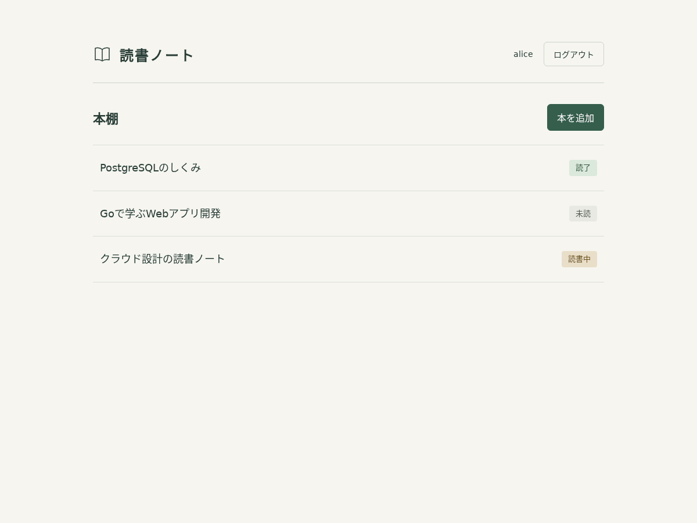
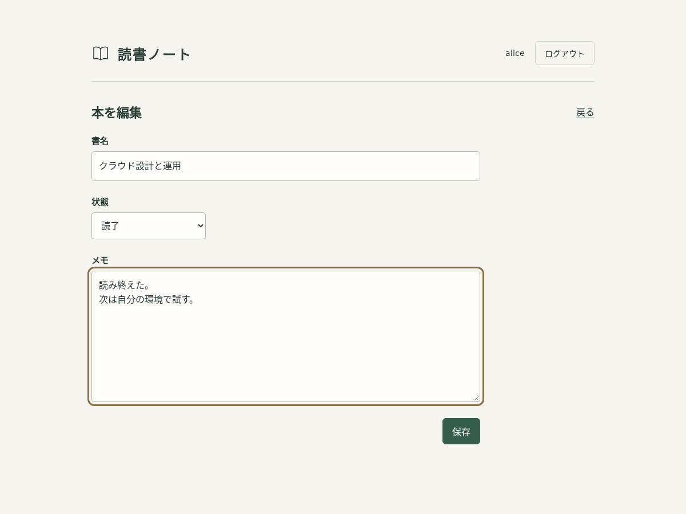
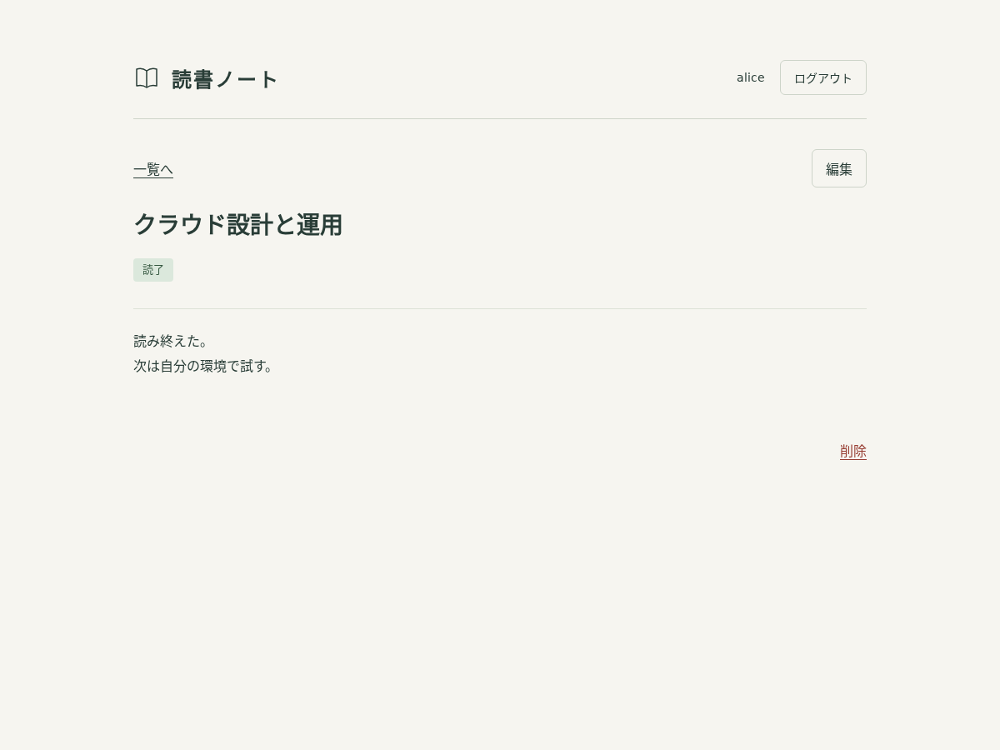
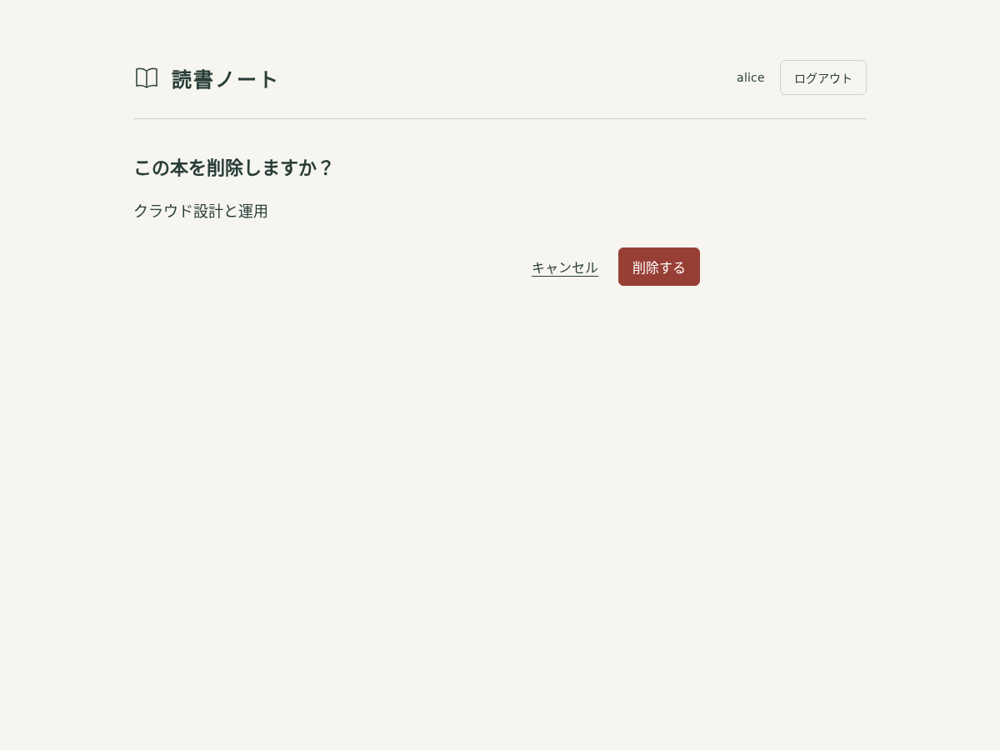
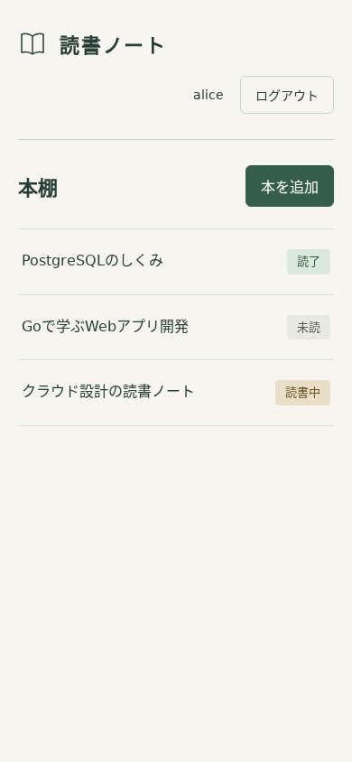

# ステップ4：読書タスクのCRUDと認可

実施日：2026-11-15（日本時間）

## 対象と環境

既存のGo・PostgreSQL・Keycloak構成に読書タスクの画面とSQLを追加した。Goは `.tools/go`、DBとKeycloakはDocker Compose、ブラウザーは既存のPlaywright/Chromiumを使用。新しいGo依存パッケージ、マイグレーション、AWSリソースは追加していない。

今回決めたこと・採用理由・完了条件は[操作・設計・調査手順](../runbooks/reading-tasks.md)に記載。

## 検証結果

| 確認 | 実測結果 |
| --- | --- |
| `bash scripts/dev.sh test -count=1 ./...` | auth / books / database / webが成功。テスト専用DBを使う結合テストも実行 |
| `bash scripts/go.sh vet ./...` | 成功 |
| `bash scripts/go.sh build -o bin/readinglog ./cmd/web` | 成功 |
| `python3 scripts/verify-login.py` | Alice・Bobともログイン、コールバック再送拒否、CSRF拒否、ログアウト、失効Cookieの拒否に成功 |
| `scripts/verify-books.py`（Chromium） | 2ユーザーの実セッションでCRUD・認可・改ざん拒否・画面を確認。すべて成功 |

### Go・実DBで確認したこと

- 所有者は認証済みセッションから渡され、フォームには依存しない。
- 自分の本を追加・取得・更新・削除でき、更新日時も変わる。
- 他人の本は一覧に出ず、IDを直接指定した取得・更新・削除も拒否。元のデータと所有者が変わらない。
- 他人の本と存在しない本は同じ404画面。未ログインの全CRUDルートはトップへ戻る。
- CSRFなし・不一致・別ユーザーのCSRF、Originなし・別Origin、所有者の追加・クエリ改ざん、重複項目、大きすぎる本文、不正なContent-Typeを拒否し、DB書き込みが増えない。
- 書名・メモの文字数、不正な状態、無効UTF-8、NULを検証。300文字の書名と10,000文字のメモ（絵文字を含む）の許可も確認。
- HTMLを含む書名・メモは画面でエスケープされ、SQLのような文字列も値として保存される。
- 削除確認のGETではデータが消えず、POSTで削除する。
- 21件を20件＋1件に分けて取得し、重複・漏れ・他人のデータ混入がない。一覧SQLはメモを読み込まない。
- セッションまたはタスク保存先の障害をテストで再現し、503となり内部エラー文字列を画面・ログへ出さない。実際のDB障害調査は次のステップで行う。

### 実ブラウザーで確認したこと

- AliceとBobを別のブラウザーコンテキストで実Keycloakへログイン。
- Aliceが3冊を作成し、未読・読書中・読了を一覧表示。詳細、編集、メモの改行保持を確認。
- BobからAliceの詳細・編集・削除確認へ直接アクセスすると404。Bobの正しいCSRFでもAliceの本の更新・削除は404。
- AliceからBobの本の参照も404。所有者追加・クエリ改ざんは400、CSRF不一致・別Originは403、空白だけの書名は422。
- 拒否後もAliceの本が変わらない。削除確認でキャンセルすると残り、「削除する」で消える。
- PC幅1200pxとスマートフォン幅390pxを確認。一覧・フォームで横方向にはみ出さない。画像も目視確認。
- 検証用に作成した本は返されたIDで後片付けし、両ユーザーをログアウト。既存の本は削除しない。

```text
PASS: real sessions, CRUD, ownership checks, tampering, CSRF, validation, mobile layout
PASS: deletion requires confirmation POST; deleted book returns 404
PASS: test books removed and sessions logged out
```

### ログ

ブラウザー検証時の操作ログを解析し、作成・更新・削除・404・拒否イベントの `request_id` がHTTPログと結び付くことを確認した。実際のローカルパスワード・クライアントシークレット、送信した書名・メモはログに含まれない。CSRF値が記録されないことはHTTPテストでも確認した。

生ログはGit管理対象外の `.cache/verification/04-app.jsonl` に置き、リポジトリには含めない。

## 画面











## 範囲

ローカルCRUDと所有者制限までを完了。バックアップ・別DBへの復元、AWS上の認証・通信・権限・デプロイは未検証。Goのrace detectorは既存環境でCGO/Cコンパイラーを用意していないため未実行。次はTODOのステップ5へ進む。
